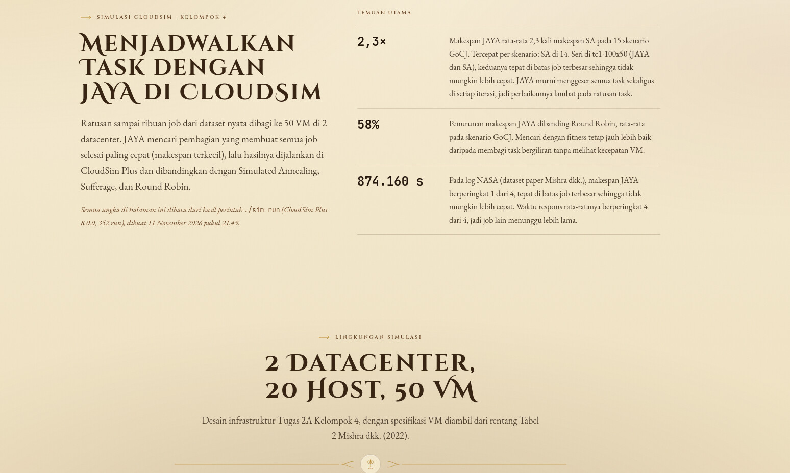
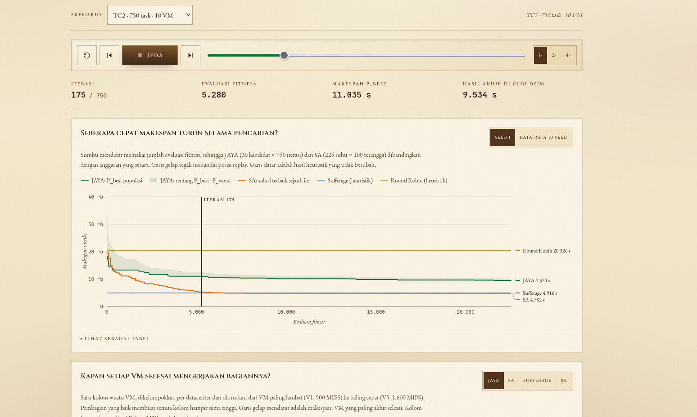

# Metaheuristik — JAYA & Simulated Annealing

Website edukasi interaktif satu halaman (single-page) yang menjelaskan dua algoritma metaheuristik:

- **JAYA** — algoritma berbasis populasi (R.V. Rao, 2016).
- **Simulated Annealing (SA)** — algoritma berbasis solusi tunggal yang meniru proses pendinginan logam.

Materi disusun dari presentasi kuliah Metaheuristik **Kelompok 4 Kelas C, Institut Teknologi Sepuluh Nopember (ITS)**, lalu diubah menjadi halaman yang bisa dibaca, dihitung ulang, dan disimulasikan langsung di browser. Seluruh antarmuka berbahasa Indonesia.

Tema visualnya adalah **perkamen, kulit, dan emas** dengan ornamen klasik yang seluruhnya dibuat sendiri lewat CSS/SVG/canvas — tidak memakai aset berhak cipta.

---

## Daftar Isi

- [Ringkasan fitur](#ringkasan-fitur)
- [Teknologi](#teknologi)
- [Menjalankan proyek](#menjalankan-proyek)
- [Simulasi CloudSim JAYA](#simulasi-cloudsim-jaya)
- [Struktur halaman](#struktur-halaman)
- [Struktur folder](#struktur-folder)
- [Arsitektur kode](#arsitektur-kode)
- [Logika algoritma](#logika-algoritma)
- [Penjelasan simulator & alat interaktif](#penjelasan-simulator--alat-interaktif)
- [Scene 3D](#scene-3d)
- [Sistem desain](#sistem-desain)
- [Aksesibilitas & performa](#aksesibilitas--performa)
- [Pengujian](#pengujian)
- [Dokumen perencanaan](#dokumen-perencanaan)
- [Catatan akurasi materi](#catatan-akurasi-materi)
- [Konfigurasi build](#konfigurasi-build)

---

## Ringkasan fitur

| Fitur | Keterangan |
| --- | --- |
| Navigasi sticky | Menu atas dengan scroll-spy, progress bar scroll, dan menu mobile. |
| Animasi scroll-reveal | Kartu dan judul muncul saat masuk viewport (`framer-motion`). |
| Stepper "Cara Kerja" | 5 langkah JAYA dan 10 langkah SA: rumus KaTeX, penjelasan, contoh angka, ilustrasi per langkah. |
| Sinkronisasi stepper → simulator | Memilih langkah JAYA memajukan simulator ke fase algoritma yang sesuai. |
| Simulator JAYA | Populasi kandidat di atas heatmap fungsi uji; vektor tarik ke `P_best` dan tolak dari `P_worst`; seleksi greedy. |
| Simulator SA | Satu solusi, kurva pendinginan, kriteria Metropolis, meter probabilitas, termometer, jejak solusi. |
| Demo penjadwalan task → node | Papan ETC interaktif (drag/klik), makespan, pembanding JAYA diskret, dan brute-force optimal. |
| Kalkulator | Pembaruan JAYA satu variabel, probabilitas Metropolis, tabel pendinginan, estimasi `T₀`. |
| Arena perbandingan | JAYA vs SA pada lanskap yang sama dengan anggaran evaluasi identik, plus uji 20 kali (mean ± std). |
| Visualisasi 3D | Hero landscape, tempa logam (annealing), dan arena populasi JAYA — semuanya bisa diputar/zoom. |
| Reproducible | Semua keacakan memakai RNG ber-seed (mulberry32) sehingga hasil dapat diulang. |
| Aksesibilitas | Fokus keyboard terlihat, `aria-label` pada kontrol, dukungan `prefers-reduced-motion`, fallback tanpa WebGL. |
| Halaman `/cloudsim/` | Hasil simulasi JAYA vs SA vs Sufferage vs Round Robin di CloudSim Plus: replay per iterasi, grafik konvergensi, beban VM, tren TC1/TC2, tabel metrik, validasi. |
| CLI `./sim` | Simulasi CloudSim sungguhan di terminal: wizard, tampilan live (progress, sparkline makespan, beban VM per datacenter), dan tabel hasil. |

---

## Teknologi

| Lapisan | Pustaka |
| --- | --- |
| Build tool | Vite 5 |
| UI | React 18 + TypeScript 5 |
| Styling | Tailwind CSS 3 + CSS global (token warna, tekstur, komponen) |
| Animasi | framer-motion 11 |
| 3D | three.js + `@react-three/fiber` + `@react-three/drei` (OrbitControls) |
| Matematika | KaTeX (`katex` dirender manual, bukan wrapper React) |
| State management | Zustand 5 |
| Unit test | Vitest 2 |
| Visualisasi 2D | Canvas 2D (heatmap lanskap, bidak, panah) + SVG (grafik, ilustrasi) |

Tidak ada backend. Seluruh perhitungan algoritma pada halaman materi berjalan di sisi klien.

Simulasi CloudSim dijalankan terpisah lewat CLI Java di `cloudsim-jaya/`:

| Lapisan | Pustaka |
| --- | --- |
| Bahasa dan build | Java 17 (release 17), Maven, fat-jar `maven-shade-plugin` |
| Simulator | CloudSim Plus 8.0.0 (`org.cloudsimplus:cloudsim-plus`) |
| Unit test | JUnit 5 |
| Tampilan terminal | Kode ANSI manual tanpa library tambahan |

---

## Menjalankan proyek

Butuh **Node.js 20+**.

```bash
npm install
npm run dev       # dev server, http://localhost:5173
```

Perintah lain:

```bash
npm run build      # type-check (tsc -b) + build produksi ke dist/
npm run preview    # menyajikan hasil build secara lokal
npm test           # menjalankan seluruh unit test Vitest sekali
npm run test:watch # mode watch
```

> Catatan: `npm run build` menjalankan `tsc -b` lebih dulu, jadi error TypeScript akan menggagalkan build.

---

## Simulasi CloudSim JAYA

Selain halaman materi (`/`), repo ini memuat bagian kedua: **penjadwalan task dengan JAYA di CloudSim Plus 8.0.0**, dibandingkan dengan Simulated Annealing, Sufferage, dan Round Robin. Bagian ini terdiri dari dua bagian yang saling melengkapi:

| Bagian | Fungsi | Lokasi |
| --- | --- | --- |
| **CLI simulasi** (Java 17, Maven) | Menjalankan CloudSim sungguhan. Ada wizard dan tampilan live di terminal: makespan yang turun, beban setiap VM, dan validasi CloudSim. | [`cloudsim-jaya/`](cloudsim-jaya/README.md) |
| **Halaman `/cloudsim/`** (React) | Etalase hasil 16 skenario resmi: replay pencarian JAYA per iterasi, grafik konvergensi, beban VM, perbandingan TC1/TC2, tabel metrik, dan validasi CloudSim. | `cloudsim/index.html` dan `src/cloudsim/` |
| Data penghubung | JSON yang ditulis `./sim run` lalu dibaca halaman | `public/data/cloudsim/` (`summary.json`, `replay/*.json`) |

Halaman `/cloudsim/` **statis**: setiap klik hanya membuka data yang sudah jadi, dan tidak ada simulasi yang berjalan di browser. Karena itu halaman ini tetap berjalan di GitHub Pages tanpa Java: **https://fawwazjs.github.io/Metaheuristic_JAYA_SA_Algorithm/cloudsim/**. Simulasi yang bisa ditonton langsung ada di terminal.





Screenshot lain (lingkungan simulasi dan perbandingan algoritma) ada di [README CLI](cloudsim-jaya/README.md#halaman-website-cloudsim).

### Mencoba website dan CLI bersamaan

```bash
# Terminal 1: website
npm run dev                      # buka http://localhost:5173/cloudsim/

# Terminal 2: CLI (target/cloudsim-jaya.jar sudah ada; build ulang dengan mvn -q package bila perlu)
cd cloudsim-jaya
./sim                            # wizard: pilih dataset, VM, algoritma, seed, lalu tonton prosesnya
./sim run                        # 16 skenario resmi (±4,5 menit), lalu refresh halaman
```

Hasil tersimpan di dua tempat yang berbeda:

| Perintah | Hasil disimpan di | Muncul di halaman? |
| --- | --- | --- |
| `./sim run` (16 skenario resmi, 352 run) | `cloudsim-jaya/results/` dan `public/data/cloudsim/` | Ya, setelah refresh |
| `./sim` / `./sim custom` (uji coba) | `cloudsim-jaya/results/custom/<id>/` (tidak ikut git) | Tidak, hanya di terminal |

### Contoh untuk demo

Angka hasilnya selalu sama, karena seed tetap. Penjelasan lengkap, cuplikan layar terminal, dan poin yang bisa disampaikan ke dosen ada di [panduan demo](cloudsim-jaya/README.md#panduan-demo-4-contoh-2-jaya-2-sa).

| # | Perintah (dari folder `cloudsim-jaya`) | Yang ditunjukkan | Hasil |
| --- | --- | --- | --- |
| 1 | `./sim custom --dataset gocj --tasks 300 --vms 20 --algo jaya --runs 3` | JAYA: P_best dan P_worst menyempit | 1.702,1 ± 21,7 s |
| 2 | `./sim custom --dataset nasa --tasks 750 --vms 50 --algo jaya,rr --runs 1` | JAYA mencapai batas mutlak job terbesar di dataset paper | JAYA 874.160 s, RR 1.409.838 s |
| 3 | `./sim custom --dataset gocj --tasks 300 --vms 20 --algo sa --runs 3` | SA pada skenario yang sama dengan contoh 1 | 1.002,3 ± 6,0 s (41% lebih rendah dari JAYA) |
| 4 | `./sim custom --dataset gocj --tasks 750 --vms 10 --algo sa,sufferage,rr --runs 3` | SA hanya 0,26% di atas batas teoretis | SA 4.781,2 s, Sufferage 4.915,8 s, RR 20.326 s |

### Temuan utama (352 run, semua tervalidasi di CloudSim)

- **GoCJ:** SA tercepat di 14 dari 15 skenario. JAYA rata-rata 2,3 kali makespan SA, tetapi 58% lebih rendah dari Round Robin.
- **NASA:** JAYA mencapai makespan terendah (874.160 s, batas job terbesar) di semua seed, tetapi waktu responsnya paling buruk.
- **Validasi:** semua cloudlet berstatus SUCCESS, dan selisih evaluator dengan CloudSim paling besar 0,29%.

Alamat `/cloudsim` tanpa garis miring dialihkan ke `/cloudsim/` di dev dan preview server; GitHub Pages melakukan hal yang sama.

---

## Struktur halaman

Urutan section di `src/App.tsx`:

| # | Section (`id`) | Isi |
| --- | --- | --- |
| 0 | Curtain pembuka | Layar muat singkat dengan monogram, bisa dilewati dengan klik. |
| 1 | `#gerbang` — Hero | Judul "METAHEURISTIK", subjudul, identitas kelompok, latar lanskap 3D, tombol "Mulai". |
| 2 | `#peta` — Daftar Isi | Enam kartu navigasi bernomor I–VI + ringkasan dua pendekatan. |
| 3 | `#pengantar` — Pengantar | Apa itu metaheuristik, kontras populasi vs solusi tunggal. |
| 4 | `#jaya` — Bab JAYA | Definisi, filosofi, karakteristik, keunggulan/kelemahan, stepper 5 langkah, simulator, kalkulator, visualisasi 3D. |
| 5 | `#sa` — Bab SA | Definisi, karakteristik, keunggulan/kelemahan, stepper 10 langkah, demo penjadwalan, simulator, kalkulator, 3D pendinginan logam. |
| 6 | `#arena` — Perbandingan | Tabel 8 aspek, grafik best-so-far, uji 20 kali, canvas duel lanskap. |
| 7 | `#arsip` — Referensi | Dua paper sumber + "Catatan Akurasi". |
| 8 | `#penutup` — Penutup | Ucapan terima kasih, daftar anggota kelompok, tautan kembali ke atas. |

Navbar memiliki progress bar scroll (`useScroll` + `useSpring`) dan scroll-spy (`useScrollSpy`, garis baca 120 px). Mendukung `Escape` untuk menutup menu mobile.

---

## Struktur folder

```
.
├── index.html                  # entry HTML, font Google, meta deskripsi
├── src/
│   ├── main.tsx                # bootstrap React
│   ├── App.tsx                 # susunan section + curtain pembuka + lapisan tekstur
│   ├── styles/index.css        # import KaTeX, Tailwind layer, token, tekstur, komponen
│   ├── lib/
│   │   ├── content.ts          # SELURUH teks materi (sumber kebenaran konten)
│   │   ├── hooks.ts            # useScrollSpy, useMediaQuery, useInViewport, usePrefersReducedMotion
│   │   └── algorithms/
│   │       ├── rng.ts          # mulberry32, hashSeed, randomSeed, Box–Muller, format angka
│   │       ├── landscapes.ts   # 5 fungsi uji, normalisasi, warna heatmap
│   │       ├── jaya.ts         # JayaEngine berbasis fase
│   │       ├── sa.ts           # AnnealingEngine generik + versi kontinu
│   │       ├── scheduling.ts   # dataset ETC, makespan, 6 operator perturbation, brute force
│   │       ├── duel.ts         # perbandingan adil JAYA vs SA
│   │       └── algorithms.test.ts
│   ├── store/
│   │   ├── jayaStore.ts        # state simulator JAYA (zustand)
│   │   └── saStore.ts          # state simulator SA (zustand)
│   ├── components/
│   │   ├── layout/             # Navbar, Footer, SectionFrame, SubHeading
│   │   ├── content/            # Hero, Sections, JayaChapter, SaChapter, Stepper, Blocks, Plates
│   │   ├── sim/                # JayaSim, SaSim, CompareArena, TaskSchedulingDemo, Calculators, canvas
│   │   ├── three/              # HeroLandscape, AnnealingForge, JayaArena3D, scene, Illustrations
│   │   ├── ui/                 # Controls (Lever/Segmented/...), ParchmentCard, Reveal, WaxSealButton
│   │   ├── ornaments/          # ikon, crest, divider, torch, partikel bara
│   │   └── math/Tex.tsx        # renderer KaTeX
│   └── cloudsim/               # halaman /cloudsim/: CloudSimPage, data.ts, replay.ts (+ tes), usePlayer, components/
├── cloudsim/index.html         # entry HTML kedua untuk halaman /cloudsim/
├── cloudsim-jaya/              # CLI Java: simulasi JAYA/SA/Sufferage/RR di CloudSim Plus (lihat README-nya)
├── public/                     # favicon.svg, .nojekyll, data/cloudsim/ (JSON hasil ./sim run)
├── docs/images/cloudsim/       # screenshot halaman /cloudsim/ untuk README
├── .github/workflows/          # deploy GitHub Pages (npm test + npm run build)
├── .qa/                        # skrip audit browser + screenshot (git-ignored)
├── 00-PROMPT-UTAMA.md          # brief proyek
├── 01-CONTENT.md               # materi asli (sumber kebenaran)
├── 02-DESIGN.md                # pedoman visual
├── 03-ANIMATIONS.md            # pedoman animasi & simulasi
├── Metaheuristik_compressed.pdf # PDF presentasi sumber
├── tailwind.config.js          # token warna, font, shadow, keyframes
├── vite.config.ts              # plugin, base path, manual chunk, konfigurasi Vitest
└── tsconfig*.json
```

---

## Arsitektur kode

Prinsip utamanya: **logika algoritma dipisahkan total dari UI**.

```
lib/algorithms  →  store/zustand  →  components/sim  →  components/three
   (murni, bisa dites)   (orkestrasi)     (canvas 2D)       (scene 3D)
```

### 1. Mesin berbasis fase / langkah

Kedua algoritma tidak dijalankan sekaligus, tetapi sebagai **state machine** yang bisa dimajukan satu langkah. Ini yang membuat stepper, tombol "Satu fase", dan animasi bisa sinkron.

**`JayaEngine`** (`jaya.ts`) memiliki fase:

```
init → evaluate → bestWorst → update → select → iterate → (bestWorst | done)
```

Satu panggilan `step()` memajukan tepat satu fase dan mengembalikan `JayaSnapshot` lengkap (posisi, fitness, `P_best`/`P_worst`, usulan pembaruan, riwayat, statistik, alasan berhenti).

**`AnnealingEngine<T>`** (`sa.ts`) generik terhadap tipe state `T`, sehingga satu implementasi dipakai untuk:

- vektor kontinu 2D (`number[]`) pada simulator lanskap, dan
- larik penempatan task (`number[]` dengan nilai 1..N) pada demo penjadwalan.

Satu `step()` = satu percobaan neighbor, termasuk keputusan Metropolis dan pembaruan `S_best`. Satu blok `inner loop` = satu penurunan temperatur.

### 2. Snapshot immutable

Kedua mesin mengembalikan snapshot yang menyalin array/objek. UI tidak pernah memutasi state internal mesin. Ini memungkinkan:

- `undo` dengan **replay** dari seed (bukan menyimpan seluruh riwayat),
- render ulang yang aman di React,
- unit test yang deterministik.

### 3. Zustand store

`jayaStore` dan `saStore` menyimpan pengaturan, snapshot terakhir, log percobaan, status `running`, dan aksi. Setiap perubahan parameter (fungsi uji, populasi, seed, `T₀`, `α`, dsb.) memicu `init()` atau `replay()`, sehingga simulasi selalu konsisten dari awal.

Fungsi `replay(settings, steps)` membangun ulang mesin dari seed lalu menjalankan `steps` langkah. `undo()` memakai mekanisme ini untuk mundur satu langkah tanpa menyimpan histori besar.

### 4. Canvas 2D

`components/sim/canvas.ts` menyediakan:

- `useCanvasLoop` — render loop dengan `ResizeObserver`, batas DPR 2, dan **berhenti saat elemen di luar viewport atau tab tidak aktif** (`IntersectionObserver` + `document.hidden`).
- `getHeatmap` / `paintMap` — heatmap lanskap yang di-cache dan digambar ulang.
- `mapToCanvas` / `canvasToMap` — konversi domain fungsi ↔ piksel.
- Primitif gambar: `drawArrow`, `drawGlow`, `drawPawn`, `drawCrown`, `drawFlag`, `drawSkull`, `drawSpark`.

Semua visual 2D (bidak, panah, mahkota, panji, tengkorak) digambar prosedural, tanpa file gambar.

---

## Logika algoritma

### RNG ber-seed (`rng.ts`)

| Fungsi | Kegunaan |
| --- | --- |
| `mulberry32(seed)` | PRNG 32-bit deterministik. Semua keacakan simulasi lewat sini. |
| `randomSeed()` | Seed baru 6 digit yang mudah dibaca. |
| `hashSeed(text)` | Mengubah teks menjadi seed (FNV-1a). |
| `randomInt`, `pick`, `shuffle` | Utilitas undian. |
| `makeGaussian(rng)` | Gaussian standar via Box–Muller (dengan cache satu nilai). |
| `clamp`, `lerp`, `roundTo` | Utilitas numerik. |
| `formatNumber` | Format Indonesia: koma desimal, titik ribuan, tanda minus tipografis. |
| `formatPlain` | Sama, tanpa pemisah ribuan (untuk input). |

Karena semua keacakan memakai seed yang sama, dua simulasi dengan parameter identik menghasilkan angka identik.

### Fungsi uji / landscape (`landscapes.ts`)

Lima fungsi minimasi 2D yang dipakai seluruh simulator:

| ID | Nama | Sifat | Domain | Minimum global |
| --- | --- | --- | --- | --- |
| `sphere` | Sphere | Unimodal, mulus | [-5, 5]² | 0 di (0, 0) |
| `rastrigin` | Rastrigin | Banyak optimum lokal | [-5.12, 5.12]² | 0 di (0, 0) |
| `rosenbrock` | Rosenbrock | Lembah sempit melengkung | [-2, 2]² | 0 di (1, 1) |
| `himmelblau` | Himmelblau | Empat minimum global | [-5, 5]² | 0 di (3, 2) |
| `ackley` | Ackley | Dataran beriak + kawah dalam | [-5, 5]² | 0 di (0, 0) |

Default aplikasi: **Rastrigin**.

Tambahan:

- `sampleMax()` menghitung nilai maksimum hasil sampling untuk normalisasi warna.
- `normalizeCost()` memakai skala logaritmik agar kawah tetap terbaca.
- `normalizedHeight()` memakai eksponen `heightPower` per lanskap agar relief 3D tidak terlalu curam.
- `heatColor()` / `heatColorCss()` memetakan nilai ke gradasi krem → cokelat → merah tua (6 titik henti, interpolasi smoothstep).

### JAYA (`jaya.ts`)

Rumus pembaruan, persis seperti slide (memakai nilai absolut):

```
X_i^{k+1} = X_i^k + r1·(P_best_i − |X_i^k|) − r2·(P_worst_i − |X_i^k|)
```

Langkah algoritma:

1. **Inisiasi populasi** — nilai acak seragam dalam `[min, max]` tiap dimensi.
2. **Evaluasi fitness** — setiap kandidat dihitung dengan fungsi objektif.
3. **Penentuan `P_best` dan `P_worst`** — fitness minimum dan maksimum.
4. **Pembaruan kandidat** — semua kandidat diusulkan bergerak mendekati `P_best` dan menjauhi `P_worst`, lalu di-clamp ke batas domain.
5. **Seleksi greedy** — usulan hanya diterima jika fitness-nya **lebih kecil** dari fitness lama.
6. **Iterasi** — ulangi; berhenti saat `maxIter` tercapai atau `P_best`/`P_worst` tidak berubah selama `stagnationLimit` iterasi (default 18 di store, 15 di mesin).

Snapshot menyimpan `updates[]` per kandidat — dipakai UI untuk menampilkan panah vektor, rumus pembaruan yang sudah terisi angka, dan status diterima/ditolak. Inilah dasar fitur "klik kandidat untuk melihat perhitungannya".

Catatan: pada simulator, fitness didefinisikan sebagai nilai yang **diminimalkan** (lihat [Catatan akurasi](#catatan-akurasi-materi)).

### Simulated Annealing (`sa.ts`)

Rumus inti:

```
Penerimaan solusi buruk : P = exp(−ΔC / T),  ΔC > 0
Temperatur awal        : T₀ = −ΔC̄ / ln(HEC)
Pendinginan            : T_baru = α · T_lama
Cost solusi diskret    : f(S) = max_j C_j(S)
```

Aturan keputusan:

| Kondisi | Keputusan |
| --- | --- |
| `ΔC < 0` | Selalu diterima (`P = 1`), dihitung sebagai `improve`. |
| `ΔC = 0` | Selalu diterima, dihitung sebagai `equal`. |
| `ΔC > 0` | Diterima bila `r < exp(−ΔC/T)`; jika tidak, ditolak. |

Detail implementasi:

- `initialTemperature(meanDelta, hec)` meng-clamp `HEC` ke `[0.001, 0.999]` agar tidak terjadi pembagian nol / log tak hingga.
- `estimateInitialTemperature()` mengambil hingga 50 sampel perpindahan yang **memperburuk** cost (maksimal 150 percobaan), lalu menghitung rata-rata `ΔC`. Jika tidak ada sampel buruk, dipakai nilai cadangan `max(1, |cost|·0.25 + 1)`.
- `coolingTable()` dan `iterationsUntilFinal()` dipakai kalkulator untuk memverifikasi contoh slide.
- `T` diturunkan setiap `innerLoops` percobaan; berhenti saat `T < T_final` atau `maxEvaluations` tercapai.
- `S_best` hanya diperbarui saat solusi yang diterima benar-benar lebih baik, sehingga solusi terbaik tidak hilang meski `S_cur` sempat memburuk.
- Riwayat dibatasi: `trail` maksimum 400 titik, `trace` maksimum 600 titik, log UI 7–8 percobaan terakhir.

### Penjadwalan task → node (`scheduling.ts`)

Dataset diambil persis dari slide:

```
ETC = [[4, 6, 9],
       [7, 3, 5],
       [8, 4, 2],
       [5, 7, 4]]      // 4 task × 3 node

S₀ = [1, 2, 3, 1]      // t1→N1, t2→N2, t3→N3, t4→N1
C(S₀) = [9, 3, 2]      // beban tiap node
f(S₀) = max(9, 3, 2) = 9
```

- `nodeLoads()` menjumlahkan `ETC[i][node]` untuk task yang ditempatkan di node tersebut.
- `makespan()` mengambil beban maksimum.
- `bruteForceOptimal()` memeriksa seluruh `3⁴ = 81` kemungkinan; hasilnya **cost 6** (dihitung sekali saat modul dimuat).
- `runScheduleJaya()` menjalankan JAYA kontinu pada dataset yang sama, lalu mengonversi hasilnya ke nomor node dengan `round` + clamp ke `[1, 3]`.
- `roundToNode()` mendemonstrasikan kelemahan "konversi kontinu → diskret".

Enam operator perturbation (sesuai slide), semuanya dijamin menghasilkan larik valid dan (bila memungkinkan) berbeda dari solusi asal:

| Operator | Efek |
| --- | --- |
| New Node Insertion | Satu task dipindah ke node lain. |
| Swap | Dua task bertukar node. |
| Random Shuffle | Sebagian penempatan diacak. |
| Displacement | Segmen penempatan digeser ke posisi lain. |
| Insertion | Satu elemen diambil dan disisipkan di posisi lain. |
| Inversion | Urutan sebuah segmen dibalik. |
| `random` | Memilih salah satu dari enam operator di atas secara acak. |

### Perbandingan adil (`duel.ts`)

`runFairDuel(landscape, seed, budget = 600)` menjalankan kedua algoritma pada lanskap yang sama dengan **anggaran evaluasi fungsi identik (600)**, sehingga sumbu-x grafik adalah jumlah evaluasi — bukan iterasi. Konfigurasi:

- JAYA: populasi 10, `maxIter` 400, stagnasi 400, RNG dari seed.
- SA: `T₀` otomatis, `α = 0.985`, inner loop 12, `T_final = 0.004`, `maxEvaluations = 600`.
- Titik awal SA sengaja diletakkan di 72% / 28% domain agar tidak selalu di tengah.
- RNG SA memakai seed turunan (`seed ^ 0x5bf03635`) agar tidak berkorelasi dengan JAYA.

`summariseDuelRuns()` menghitung mean, standar deviasi, dan jumlah kemenangan untuk uji 20 kali.

---

## Penjelasan simulator & alat interaktif

### Simulator JAYA (`components/sim/JayaSim.tsx`, `store/jayaStore.ts`)

- **Kanvas heatmap** lanskap + bidak populasi, `P_best` (emas, mahkota + panji), `P_worst` (merah, tengkorak).
- **Panah vektor**: hijau ke arah `P_best`, merah putus-putus menjauhi `P_worst`, emas menuju hasil `X′`.
- **Tween posisi**: posisi tampilan bergerak halus menuju snapshot (easing 0.16), bukan melompat.
- **Trail** jejak kandidat (maksimum 18 titik per kandidat, sampling 90 ms).
- **Klik kandidat** untuk membuka panel perhitungan yang menampilkan `X`, `F(X)`, `P_best`, `P_worst`, nilai `r1`, `r2`, dan rumus pembaruan terisi angka.
- **Kontrol**: play/pause, satu fase, satu iterasi, undo, reset, slider populasi (5–60), batas iterasi (10–120), pemilihan fungsi uji, seed (+ tombol seed baru), kecepatan ¼×–4×.
- **Toggle**: vektor, jejak, kontur, mode "serentak" (semua kandidat bergerak bersamaan vs fase per fase).
- **Grafik konvergensi** SVG: best, rata-rata, worst per iterasi.
- **Keyboard**: `→` satu fase, `←` undo, `Spasi` play/pause.

### Simulator SA (`components/sim/SaSim.tsx`, `store/saStore.ts`)

- **Bola logam** yang warnanya mengikuti temperatur relatif (`temperatureColor`).
- **S_best** ditandai panji; **neighbor terakhir** digambar sebagai panah (hijau bila membaik, oranye bila buruk tapi diterima, merah putus-putus bila ditolak).
- **Termometer** di sisi kanan kanvas, dengan garis `T_final`.
- **Meter probabilitas** setengah lingkaran: menunjukkan `P` dan posisi `r` acak, dengan label DITERIMA/DITOLAK.
- **Grafik** cost vs evaluasi dan temperatur (skala log).
- **Riwayat 7 keputusan terakhir**: `ΔC`, `T`, `P`, dan status.
- **Kontrol**: satu percobaan neighbor, "Turunkan T" (satu blok inner loop), undo, reset, play/pause, kecepatan ¼×–8×.
- **Parameter**: `T₀` otomatis (dengan `HEC`) atau manual, `α` (0.8–0.999), inner loop (1–200), ukuran langkah (0.05–3), `T_final` (0.001–1), seed.
- **Toggle**: solusi sebelumnya (ghost), jejak, termometer.

### Demo penjadwalan (`components/sim/TaskSchedulingDemo.tsx`)

- Diagram batang bertumpuk: tinggi blok = `ETC(task, node)`, tinggi batang = beban node, garis putus-putus = makespan.
- Task bisa **diseret** antarnode atau **diklik** untuk pindah ke node berikutnya.
- Tabel ETC menyorot sel yang sedang aktif.
- Ringkasan solusi `S`, beban `C`, makespan, solusi optimal brute-force, dan selisih terhadap optimal.
- Tombol "Terapkan 1 perturbation", "Jalankan SA otomatis", "Satu langkah", "Reset".
- Panel log keputusan SA + panel pembanding JAYA diskret dengan grafik konvergensi mini.
- Panel perhitungan `C₁ = ETC(1,1) + ETC(4,1) = 4 + 5 = 9`.

### Kalkulator (`components/sim/Calculators.tsx`)

- **Kalkulator pembaruan JAYA** — slider `X`, `P_best`, `P_worst`, `r₁`, `r₂`, jumlah VM; menampilkan langkah perhitungan lengkap, garis bilangan penanda posisi, dan hasil pembulatan ke nomor VM. Ada tombol "Preset Contoh Slide" (menghasilkan 3).
- **Penerimaan Metropolis** — slider `ΔC` dan `T`, kurva `P` terhadap `T`, preset `ΔC=4, T=10` (≈0,6703) dan `ΔC=4, T=1` (≈0,0183).
- **Pendinginan & temperatur awal** — `α`, `T₀`, `T_final`, `ΔC̄`, `HEC`; menampilkan tiga langkah pendinginan, jumlah iterasi menuju `T_final`, dan `T₀` hasil hitung (preset 2 / 0,9 → 18,98).

### Arena perbandingan (`components/sim/CompareArena.tsx`)

- Canvas duel: dua kurva best-so-far JAYA (hijau) dan SA (oranye) di atas heatmap, dianimasikan progresif.
- Grafik SVG pembanding dengan sumbu-x jumlah evaluasi.
- Tombol "Mulai Perbandingan", "Seed baru", "Reset", dan "Jalankan 20 kali" (mean ± std + jumlah kemenangan).
- Tabel perbandingan 8 aspek: basis pencarian, inspirasi, parameter utama, memori, penerimaan solusi buruk, risiko, kekuatan, keluaran.

### Stepper "Cara Kerja" (`components/content/Stepper.tsx`)

- Tab progres per langkah (klik langsung), tombol Sebelumnya/Berikutnya.
- Handler keyboard pada kontainer langkah: `←`, `→`, `Home`, `End`.
- Transisi kartu dengan rotasi 3D halus (dinonaktifkan saat reduced motion).
- Kolom kanan menampilkan **plate ilustrasi SVG** khusus per langkah (`Plates.tsx`): 5 untuk JAYA dan 10 untuk SA, plus satu plate cadangan (`PlateSAUpdate`).
- `onStepChange` pada bab JAYA memanggil `setPhaseFocus` + `demoPhase`, sehingga simulator melompat ke fase yang sesuai.

---

## Scene 3D

Semua scene memakai `SceneCanvas` dari `components/three/scene.tsx` dengan:

- deteksi dukungan WebGL (`supportsWebGL`, hasil di-cache),
- `OrbitControls` (putar/zoom/geser, batas polar),
- `SceneLights`, terrain shader dengan efek reveal,
- `EmberField` (partikel bara),
- **fallback** `GlSceneFallback` berupa ilustrasi SVG statis bila WebGL tidak tersedia.

| Komponen | Lokasi | Perilaku |
| --- | --- | --- |
| `HeroLandscape` | Hero | Terrain lanskap 3D yang berganti otomatis tiap 14 detik antar fungsi uji, auto-rotate, tombol reset kamera, klik untuk memilih titik. |
| `JayaArena3D` | Bab JAYA | Terrain yang sama dengan simulator 2D; bidak kandidat, `P_best`, `P_worst`, panah vektor; terhubung ke `jayaStore` (play/pause/step/reset ikut simulator). |
| `AnnealingForge` | Bab SA | Kisi atom (6×6×3) di atas landasan tempa; atom menata diri saat temperatur turun. Mode pendinginan **lambat**, **cepat**, dan **manual** (slider temperatur). Warna logam mengikuti temperatur. |
| `Illustrations.tsx` | Semua bab | Ilustrasi SVG statis (isometrik Rastrigin, tempa logam) dipakai sebagai *plate*, *poster* saat lazy-load, dan *fallback*. |

Scene di-`lazy()` dan baru dimuat ketika elemen mendekati viewport (`useInViewport`), sehingga tidak membebani muatan awal.

---

## Sistem desain

### Palet warna (`tailwind.config.js` + `:root`)

| Token | Nilai | Pemakaian |
| --- | --- | --- |
| `parchment.50–400` | `#FBF4E4` → `#C4A263` | Latar kertas, kartu, teks terang |
| `leather.500–900` | `#8A5A2B` → `#1F1208` | Panel gelap, navbar, footer |
| `ink` | `#2A1B0E` | Teks utama |
| `gold` / `gold.light` / `gold.pale` | `#B8862B` / `#E3B64F` / `#F0D79A` | Aksen, ornamen, sorotan |
| `wax` | `#7A1E1E` | Segel lilin, "worst", penolakan |
| `forest` | `#3F5B3A` | Aksen JAYA, penerimaan |
| `ember` | `#C8561E` | Aksen SA, panas |
| `steel` | `#5E6A73` | Logam dingin |

### Tipografi

| Kelas | Font | Fungsi |
| --- | --- | --- |
| `font-display` | Cinzel Decorative | Judul besar |
| `font-heading` | Cinzel | Subjudul, label, tombol |
| `font-body` | EB Garamond | Teks isi (18 px, line-height 1.72) |
| `font-mono` | JetBrains Mono | Angka, rumus, kode |

Font dimuat dari Google Fonts melalui `<link>` di `index.html`.

### Tekstur & komponen CSS

Didefinisikan di `src/styles/index.css`:

- `page-noise` / `page-blotch` — noise SVG prosedural (data URI) untuk kesan kertas.
- `parchment-card`, `wood-panel`, `leather-panel`, `stone-panel`, `sim-shell` — panel bertema.
- `display-title`, `gold-text`, `eyebrow`, `label-cinzel`, `value-mono`, `drop-cap`.
- `btn-ritual`, `btn-ritual-light`, `rune-btn`, `lever`, `toggle-wood`, `formula-panel`, `hover-lift`.
- Animasi: `flicker` (obor), `sway`, `shimmer`, `seal-press`, `ember-rise`.

Kontrol antarmuka yang dapat dipakai ulang ada di `components/ui/Controls.tsx`: `Lever` (slider), `ToggleWood` (saklar), `SelectPlaque` (dropdown), `NumberField` (input angka), `Stat` (kotak statistik), `Tabs`, dan `Segmented` (tombol pilihan berjajar).

### Ornamen

Semua di `components/ornaments/Ornaments.tsx`, dibuat orisinal dengan SVG:

- Ikon antarmuka: play, pause, step, back, reset, dice, check, cross, chevron, crown, shield, skull, anvil, flame, candle.
- Crest: `CrestJaya`, `CrestSa`, `CrestMonogram`.
- Motif: `FleurDeLis`, `CrownMotif`, `SwordMotif`, `StarMotif`, `CornerFrame`, `CornerFlourish`.
- `OrnamentDivider` dengan beberapa motif (crown, sword, anvil, fleur, star).
- `Torch` (animasi api) dan `EmberParticles` (partikel bara naik).

---

## Aksesibilitas & performa

**Aksesibilitas**

- Skip link "Lompat ke konten" di `App.tsx`.
- Semua kontrol simulator memiliki `aria-label`; hasil penting diumumkan lewat `aria-live="polite"`.
- Fokus keyboard terlihat (`:focus-visible` + outline emas).
- Kanvas simulasi memakai `role="application"` + petunjuk keyboard.
- Stepper memakai `role="tablist"`/`role="tab"` dan mendukung tombol panah, `Home`, `End`.
- Tabel memakai `caption` (bisa `sr-only`), `th scope`, dan header yang jelas.
- Menu mobile bisa ditutup dengan `Escape`.

**Reduced motion**

- `prefers-reduced-motion` dideteksi lewat `useReducedMotion` (framer-motion) dan `useMediaQuery`.
- Animasi reveal, parallax, auto-rotate 3D, dan partikel dimatikan.
- Curtain pembuka langsung hilang.

**Performa**

- Scene 3D di-`lazy()` dan dimuat hanya saat mendekati viewport.
- Canvas loop berhenti saat di luar viewport atau tab tidak aktif.
- Heatmap lanskap di-cache; DPR dibatasi 2.
- `manualChunks` memisahkan `three`, `katex`, dan `framer-motion`.
- Riwayat simulasi dibatasi panjangnya agar memori stabil.

**Fallback**

- Tanpa WebGL → ilustrasi SVG statis.
- Tanpa `IntersectionObserver` → konten langsung dianggap terlihat.
- Error KaTeX → ditampilkan sebagai `<code>`.

---

## Pengujian

`npm test` menjalankan dua berkas tes Vitest (environment `node`): `src/lib/algorithms/algorithms.test.ts` untuk halaman materi, dan `src/cloudsim/replay.test.ts` untuk logika halaman `/cloudsim/` (skala sumbu, pencarian titik, format angka, dan temuan utama). CLI Java punya 117 tes JUnit sendiri (`cd cloudsim-jaya && mvn test`), dijelaskan di [README CLI](cloudsim-jaya/README.md#tes). Cakupan tes halaman materi:

1. **Format angka Indonesia** — koma desimal, titik ribuan, minus tipografis, nilai tak hingga.
2. **Pembaruan JAYA** — contoh slide `X=2, P_best=3, P_worst=1, r₁=r₂=0,5` menghasilkan `3`; memastikan `|X|` benar-benar dipakai.
3. **JAYA pada Sphere** — `bestEver` tidak pernah memburuk dan konvergen di bawah `1e-2`.
4. **Angka SA dari slide** — `C₁ = 9`, `f(S₀) = 9`, `T₀ ≈ 18,98`, `P(4, 10) ≈ 0,6703`, `P(4, 1) ≈ 0,0183`, pendinginan `α=0,998` → `9,98 / 9,96004 / 9,94012`, serta jumlah iterasi menuju `T_final`.
5. **Estimasi `T₀` otomatis** — positif dengan sampel wajar.
6. **Demo penjadwalan** — matriks ETC sesuai slide, optimal brute-force `6`, keenam operator selalu menghasilkan larik valid dan berbeda, `roundToNode` benar, JAYA diskret menghasilkan solusi valid.
7. **Perbandingan adil** — anggaran evaluasi tepat 600, tidak ada `NaN`/`Infinity` di trace, deterministik untuk seed sama, statistik mean/std wajar.
8. **RNG & landscape** — mulberry32 deterministik, semua lanskap punya rentang warna valid.

### Audit visual (opsional, dev-only)

Folder `.qa/` berisi skrip Node untuk mengemudikan Chrome lewat CDP: `audit.mjs` (keberadaan section + error konsol), `interact.mjs` (stepper & kontrol), `responsive.mjs` (360/640/1024/1440 px, deteksi overflow), `reduced.mjs` (reduced motion), `fallback.mjs` (tanpa WebGL), `schedule*.mjs` (demo penjadwalan), `shots.mjs` (screenshot). Folder ini **git-ignored** dan hanya untuk pengembangan lokal.

---

## Dokumen perencanaan

| File | Isi |
| --- | --- |
| `00-PROMPT-UTAMA.md` | Brief proyek: tujuan, tech stack, struktur halaman, definition of done, aturan. |
| `01-CONTENT.md` | **Sumber kebenaran materi** dari PDF: identitas, definisi, karakteristik, pro/kontra, 5 langkah JAYA, 10 langkah SA, referensi, catatan akurasi. |
| `02-DESIGN.md` | Pedoman visual: konsep, palet, tekstur, tipografi, layout, motion, responsif, do/don't. |
| `03-ANIMATIONS.md` | Pedoman animasi: RNG, landscape, mesin step, simulator JAYA/SA, demo penjadwalan, sinkronisasi stepper, scene 3D, performa. |
| `Metaheuristik_compressed.pdf` | PDF presentasi asli. |

`src/lib/content.ts` adalah terjemahan terstruktur dari `01-CONTENT.md`. Jika materi berubah, ubah di sana — dan perbarui unit test bila angkanya ikut berubah.

---

## Catatan akurasi materi

Beberapa hal sengaja ditangani hati-hati dan ditampilkan di bagian **"Catatan Akurasi"** pada halaman:

1. **Penomoran SA** — slide memiliki dua langkah bernomor "3". Di website dipecah menjadi langkah III (total waktu eksekusi per node) dan IV (cost function), sehingga total menjadi 10 langkah; langkah mengulang digabung dengan penurunan temperatur di langkah X.
2. **Arah optimasi fitness JAYA** — slide memakai `F1 = (1/MS) × ARU × AT` yang makin besar makin baik, tetapi `P_best` dipilih dari `F` minimum. Simulator menyeragamkan fitness sebagai nilai yang **diminimalkan** dan menjelaskannya di UI.
3. **Kriteria berhenti JAYA** — slide menyebut berhenti saat `P_best`/`P_worst` tidak berubah. Simulator menambahkan batas iterasi maksimum sebagai praktik standar dan menampilkan keduanya (alasan berhenti: `stagnasi` atau `max-iterasi`).
4. **Konversi kontinu → diskret** — JAYA pada penjadwalan menghasilkan nilai kontinu; demo memakai `round()` + clamp ke `[1, jumlah VM]`.
5. **Rumus `|X|`** — dipertahankan persis seperti slide.
6. **Istilah** — diseragamkan menjadi "algoritma" dan "metaheuristik".

Angka contoh telah diverifikasi otomatis oleh unit test: JAYA → 3; SA: `C₁ = 9`, `f(S₀) = 9`, `T₀ ≈ 18,98`, `P ≈ 0,6703` dan `0,0183`, `T₁ = 9,98`, `T₂ = 9,96004`, `T₃ ≈ 9,94012`.

---

## Konfigurasi build

`vite.config.ts` mengatur:

- **`base`** — dev server di `/`, build produksi memakai prefix nama repo (`/Metaheuristic.../`) agar aset tidak 404 saat disajikan dari sub-path. Ubah konstanta `REPO_NAME` bila nama repo berubah; untuk domain sendiri atau user site, set menjadi `''`.
- **`build.target = 'es2020'`**, `cssCodeSplit: true`.
- **Dua halaman (multi-page)** — `rollupOptions.input` berisi `index.html` (materi) dan `cloudsim/index.html` (hasil CloudSim). Plugin kecil `cloudsimTrailingSlash` mengalihkan `/cloudsim` ke `/cloudsim/` di dev dan preview server.
- **`manualChunks`** (berbentuk fungsi) — memisahkan `react`, `three`/`@react-three`, `framer-motion`, dan `katex` menjadi chunk terpisah, sehingga halaman `/cloudsim/` tidak ikut mengunduh three.js.
- **`vite preview`** memakai base yang sama dengan GitHub Pages, jadi `npm run build && npm run preview` meniru situs yang dideploy.
- **`test`** — environment `node`, mencakup `src/**/*.test.ts`.

TypeScript memakai konfigurasi ketat: `strict`, `noUnusedLocals`, `noUnusedParameters`, `noFallthroughCasesInSwitch`, `noEmit`, `moduleResolution: bundler`.

---

## Lisensi & kredit

Proyek akademik Kelompok 4 Kelas C, Institut Teknologi Sepuluh Nopember. Materi bersumber dari presentasi kuliah dan dua paper berikut:

1. Kaushik Mishra, Jharashree Pati, Santosh Kumar Majhi (2020). *A dynamic load scheduling in IaaS cloud using binary JAYA algorithm.* Journal of King Saud University – Computer and Information Sciences, 34 (2022), 4914–4930.
2. Esra Celik, Deniz Dal (2021). *A novel simulated annealing-based optimization approach for cluster-based task scheduling.* Cluster Computing (2021) 24, 2927–2956.

Simulasi CloudSim memakai dataset GoCJ (Hussain & Aleem, 2018; CC BY 4.0) dan log NASA Ames iPSC/860 1993 dari Parallel Workloads Archive; sitasi lengkapnya ada di [README CLI](cloudsim-jaya/README.md#referensi).

Seluruh ornamen, tekstur, dan ilustrasi dibuat sendiri dengan CSS, SVG, dan canvas.
