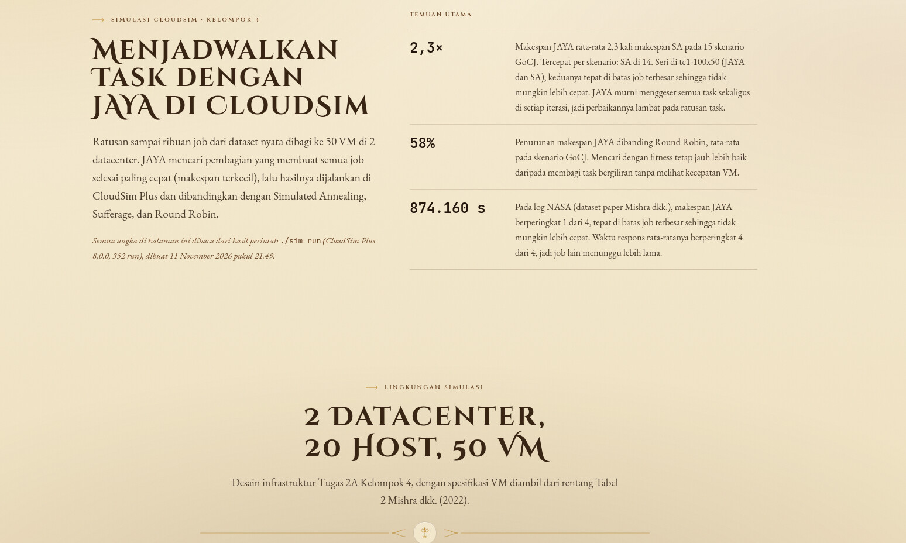
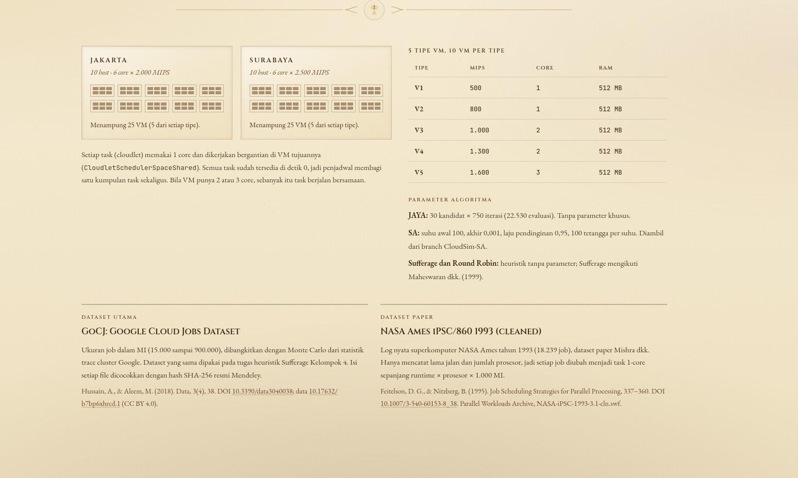
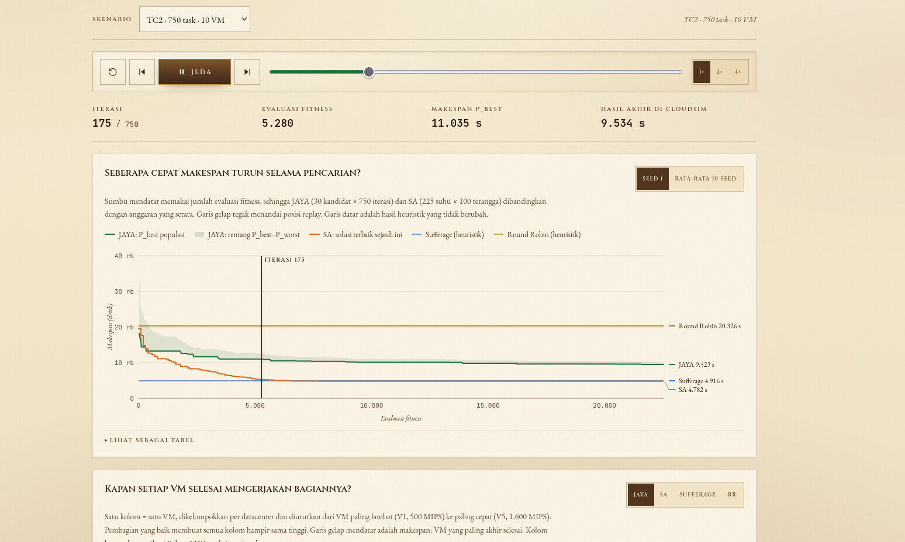
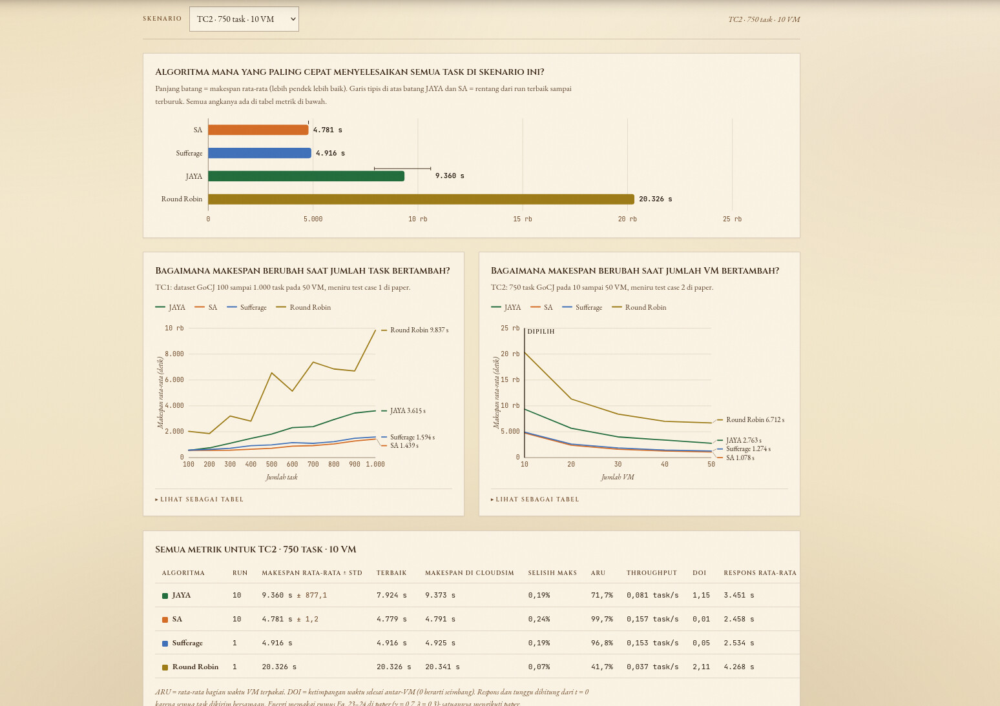
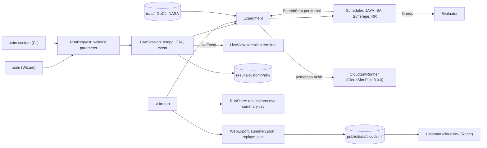

# Simulasi JAYA di CloudSim Plus

CLI untuk menjadwalkan task (cloudlet) ke VM dengan algoritma **JAYA**, menjalankannya di **CloudSim Plus 8.0.0**, lalu membandingkannya dengan **Simulated Annealing (SA)**, **Sufferage**, dan **Round Robin**. Prosesnya bisa ditonton langsung di terminal, dan hasil 16 skenario resmi tampil sebagai grafik di halaman [`/cloudsim/`](https://fawwazjs.github.io/Metaheuristic_JAYA_SA_Algorithm/cloudsim/) website kelompok.

SOKA Kelompok 4 Kelas C, Institut Teknologi Sepuluh Nopember. Implementasi CloudSim JAYA: M. Hikari Reiziq Rakhmadinta (5027241079). Implementasi SA asli: Satya Raditya (branch `CloudSim-SA`).

## Daftar isi

- [Gambaran singkat](#gambaran-singkat)
- [Prasyarat](#prasyarat)
- [Mulai cepat](#mulai-cepat)
- [Panduan demo: 4 contoh (2 JAYA, 2 SA)](#panduan-demo-4-contoh-2-jaya-2-sa)
- [Wizard interaktif](#wizard-interaktif)
- [Membaca tampilan live](#membaca-tampilan-live)
- [Tempo: terlihat atau penuh](#tempo-terlihat-atau-penuh)
- [Referensi perintah](#referensi-perintah)
- [Di mana hasil disimpan](#di-mana-hasil-disimpan)
- [Halaman website /cloudsim/](#halaman-website-cloudsim)
- [Apa yang disimulasikan](#apa-yang-disimulasikan)
- [Hasil 16 skenario resmi](#hasil-16-skenario-resmi)
- [Validasi terhadap CloudSim](#validasi-terhadap-cloudsim)
- [Arsitektur](#arsitektur)
- [Tes](#tes)
- [Pemecahan masalah](#pemecahan-masalah)
- [Keterbatasan](#keterbatasan)
- [Referensi](#referensi)

## Gambaran singkat

Bayangkan sebuah gudang ekspedisi:

| Analogi | Istilah teknis |
| --- | --- |
| Paket | Task / cloudlet. GoCJ memberi ukuran setiap paket dalam MI (juta instruksi). |
| Kurir | VM. Ada kurir lambat (V1, 500 MIPS, 1 core) sampai kurir cepat (V5, 1.600 MIPS, 3 core). |
| Rencana pembagian | Pemetaan: paket ke-i diberikan ke kurir mana. Untuk JAYA, satu kandidat = satu rencana pembagian lengkap. |
| Kapan paket terakhir sampai | **Makespan**, angka yang ingin dibuat sekecil mungkin. |

Contoh kecil: 3 paket berukuran 1.000, 1.000, dan 2.000 MI, dan dua kurir 1.000 MIPS (1 core). Kalau semuanya diberikan ke kurir A, paket terakhir sampai di detik 4. Kalau paket 2.000 MI ke A dan dua paket 1.000 MI ke B, keduanya selesai di detik 2. Makespan turun dari 4 ke 2 detik hanya karena pembagiannya lebih baik.

- **JAYA** memegang 30 rencana sekaligus. Setiap putaran semua rencana bergerak **meniru rencana terbaik (P_best) dan menjauhi rencana terburuk (P_worst)**, lalu rencana baru hanya dipakai kalau lebih baik.
- **SA** memegang satu rencana. Setiap langkah ia memindahkan satu paket ke kurir acak, dan **kadang menerima rencana yang lebih buruk** supaya tidak terjebak. Peluang itu mengecil seiring "suhu" turun.

Pembagian kerja program ini juga seperti dapur dan etalase:
- **Terminal (`./sim`) adalah dapurnya.** Di sinilah CloudSim benar-benar dijalankan, dan prosesnya bisa ditonton.
- **Halaman `/cloudsim/` adalah etalasenya.** Halaman itu statis: hanya menampilkan hasil `./sim run` yang sudah jadi, dan tidak menjalankan simulasi apa pun saat diklik.

## Prasyarat

| Kebutuhan | Untuk apa |
| --- | --- |
| **Java 17 atau lebih baru** | Menjalankan `./sim`. Cukup JRE bila `target/cloudsim-jaya.jar` sudah ada. |
| **JDK lengkap + Maven 3.8+** | Hanya untuk build ulang (`mvn -q package`). JDK harus punya `lib/ct.sym`. Di Fedora: `sudo dnf install maven`. |
| **Node.js 20+** | Hanya untuk membuka website di laptop (`npm run dev`). |
| Terminal UTF-8 | Agar balok `▁▂▃▄▅▆▇█` tampil benar. Terminal Linux modern sudah UTF-8. |

## Mulai cepat

```bash
cd cloudsim-jaya
mvn -q package   # sekali saja: build + 117 tes, menghasilkan target/cloudsim-jaya.jar
./sim            # wizard: pilih dataset, VM, algoritma, dan seed, lalu tonton prosesnya
```

Perintah lain yang paling sering dipakai:

```bash
./sim custom --dataset gocj --tasks 300 --vms 20 --algo jaya,sa --runs 3   # uji coba tanpa wizard
./sim run                                                                 # 16 skenario resmi, ±4,5 menit
./sim info                                                                # infrastruktur, dataset, skenario
./sim help                                                                # semua perintah dan opsi
```

Untuk mencoba website dan CLI bersamaan, pakai dua terminal:

| Terminal | Perintah | Hasil |
| --- | --- | --- |
| 1 (website) | `npm run dev` dari folder utama repo | Buka `http://localhost:5173/cloudsim/`. Biarkan menyala. |
| 2 (CLI) | `cd cloudsim-jaya && ./sim` | Wizard dan tampilan live di terminal. |

## Panduan demo: 4 contoh (2 JAYA, 2 SA)

Keempat contoh di bawah sudah dijalankan sungguhan. Karena seed menentukan semua angka acak, **angka yang muncul saat demo akan sama persis** dengan yang tertulis di sini. Waktu jalan bisa sedikit berbeda.

Jalankan dari folder `cloudsim-jaya`. Setiap contoh bisa juga dibuat lewat wizard `./sim`, yang di akhir menampilkan "Perintah setara" yang sama.

| # | Algoritma | Perintah | Lama |
| --- | --- | --- | --- |
| 1 | JAYA | `./sim custom --dataset gocj --tasks 300 --vms 20 --algo jaya --runs 3` | ±8 detik |
| 2 | JAYA | `./sim custom --dataset nasa --tasks 750 --vms 50 --algo jaya,rr --runs 1` | ±20 detik |
| 3 | SA | `./sim custom --dataset gocj --tasks 300 --vms 20 --algo sa --runs 3` | ±8 detik |
| 4 | SA | `./sim custom --dataset gocj --tasks 750 --vms 10 --algo sa,sufferage,rr --runs 3` | ±9 detik |

### Contoh 1 (JAYA): melihat P_best dan P_worst menyempit

```bash
./sim custom --dataset gocj --tasks 300 --vms 20 --algo jaya --runs 3
```

300 paket GoCJ dibagi ke 20 kurir, diulang dengan 3 seed. Cuplikan di tengah run kedua:

```text
✓ [1/3] JAYA seed 1  makespan 1.683,8 s · CloudSim 1.687,3 s (selisih 0,21%) · 300/300 cloudlet SUCCESS
Keseluruhan  [███████░░░░░░░░░░░░░]  1/3 run · sisa ~4 detik
Run 2/3      JAYA seed 2 · iterasi 430/750  [███████████░░░░░░░░░]
Makespan     P_best 1.868,8 s █▄▄▄▄▃▃▃▃▃▃▃▃▂▂▂▂▂▂▂▂▂▂▂▂▂▂▂▁▁ (awal 3.824,0 s) · P_worst 2.163,0 s
Beban VM     makin tinggi balok = makin lama VM bekerja; makespan 1.868,8 s
  DC-Jakarta  ▆█▄██▆▆▃▅█  paling akhir 1.868,8 s
  DC-Surabaya █▇██▂▇▄█▇▂  paling akhir 1.864,0 s
```

Hasil akhir:

| Seed | Makespan | CloudSim | Selisih |
| ---: | ---: | ---: | ---: |
| 1 | 1.683,8 s | 1.687,3 s | 0,21% |
| 2 | 1.726,0 s | 1.728,4 s | 0,14% |
| 3 | 1.696,5 s | 1.699,1 s | 0,15% |
| **Rata-rata** | **1.702,1 ± 21,7 s** | | ARU 69,4%, DOI 1,12 |

Yang bisa dijelaskan:
- **Kandidat.** JAYA memegang 30 rencana pembagian. Setiap iterasi, semua rencana bergerak dengan rumus slide `X' = X + r1(P_best − |X|) − r2(P_worst − |X|)`, lalu seleksi greedy hanya menerima rencana yang lebih baik.
- **Sparkline turun.** Makespan P_best turun dari sekitar 3.800 detik (rencana acak awal) ke sekitar 1.700 detik. P_worst ikut turun karena seluruh populasi membaik.
- **Balok VM belum rata.** Sebagian kurir masih jauh lebih cepat selesai. DOI 1,12 berarti pembagiannya masih timpang.
- **Batas bawah.** Untuk skenario ini batasnya 970,2 detik (total 300 paket ÷ total kapasitas 20 VM). JAYA masih sekitar 75% di atasnya.
- **Validasi.** Setiap rencana akhir dijalankan ulang di CloudSim Plus. Selisihnya di bawah 1%, dan semua 300 cloudlet berstatus SUCCESS.

### Contoh 2 (JAYA): dataset paper NASA, JAYA mencapai batas mutlak

```bash
./sim custom --dataset nasa --tasks 750 --vms 50 --algo jaya,rr --runs 1
```

750 job pertama log superkomputer NASA Ames 1993, yaitu dataset yang dipakai paper Mishra dkk., dibandingkan dengan Round Robin.

| Algoritma | Makespan | CloudSim | ARU | Respons rata-rata |
| --- | ---: | ---: | ---: | ---: |
| JAYA | **874.160,0 s** | 874.160,7 s | 25,5% | 130.792,1 s |
| Round Robin | 1.409.838,0 s | 1.409.841,1 s | 17,5% | 103.241,6 s |

Yang bisa dijelaskan:
- **Batas mutlak.** 874.160 detik adalah job terbesar (1.398.656.000 MI) dibagi kurir tercepat (1.600 MIPS). Satu job raksasa ini tidak bisa dipecah, jadi **tidak ada algoritma yang bisa lebih cepat**, dan JAYA tepat berada di batas itu.
- **Dibanding Round Robin**, makespan JAYA 38% lebih rendah.
- **Kelemahannya, dilaporkan apa adanya:** waktu respons rata-rata JAYA lebih buruk (130.792 vs 103.242 detik), karena job-job lain menunggu lebih lama.
- **Kenapa lebih lama.** Perhatikan baris `validasi CloudSim 124.399/874.160 s`. CloudSim harus menyimulasikan 874.160 detik waktu simulasi dengan pembaruan setiap 1 detik, jadi validasi NASA memakan sekitar 8–15 detik per run.

### Contoh 3 (SA): satu solusi yang kadang menerima langkah mundur

```bash
./sim custom --dataset gocj --tasks 300 --vms 20 --algo sa --runs 3
```

Skenario yang sama persis dengan contoh 1, supaya JAYA dan SA bisa dibandingkan langsung.

```text
✓ [1/3] SA seed 1  makespan 995,9 s · CloudSim 997,2 s (selisih 0,13%) · 300/300 cloudlet SUCCESS
Keseluruhan  [███████░░░░░░░░░░░░░]  1/3 run · sisa ~4 detik
Run 2/3      SA seed 2 · langkah suhu 105/225  [█████████░░░░░░░░░░░]
Makespan     terbaik 1.019,0 s █▆▆▄▄▄▃▃▃▂▂▂▂▁▁▁▁▁▁▁▁▁▁▁▁▁▁▁▁▁ (awal 5.904,0 s) · dipegang 1.019,0 s
Beban VM     makin tinggi balok = makin lama VM bekerja; makespan 1.019,0 s
  DC-Jakarta  ██████████  paling akhir 1.018,1 s
  DC-Surabaya ██████████  paling akhir 1.019,0 s
```

| Seed | Makespan | CloudSim | Selisih |
| ---: | ---: | ---: | ---: |
| 1 | 995,9 s | 997,2 s | 0,13% |
| 2 | 1.003,1 s | 1.005,1 s | 0,21% |
| 3 | 1.007,8 s | 1.008,3 s | 0,04% |
| **Rata-rata** | **1.002,3 ± 6,0 s** | | ARU 97,0%, DOI 0,11 |

Yang bisa dijelaskan:
- **Satu solusi.** Tetangga = pindahkan satu paket ke kurir acak. Rencana yang lebih buruk tetap bisa diterima dengan peluang `e^(−Δ/T)`. Karena itu ada dua angka: **terbaik** (rencana terbaik yang pernah ditemukan) dan **dipegang** (rencana yang sedang dipegang SA, yang boleh lebih buruk).
- **Suhu.** Suhu turun dari 100 ke 0,001 dengan α = 0,95, jadi ada 225 langkah suhu × 100 tetangga = 22.501 evaluasi. Angka ini hampir sama dengan JAYA (30 × 751 = 22.530), sehingga perbandingannya adil.
- **Balok VM rata.** Semua kurir selesai hampir bersamaan, sesuai DOI 0,11 dan ARU 97%.
- **Dibanding contoh 1.** Pada skenario dan anggaran evaluasi yang sama, makespan SA (1.002,3 s) **41% lebih rendah** dari JAYA (1.702,1 s), dan hanya 3,3% di atas batas bawah 970,2 s.

### Contoh 4 (SA): mendekati batas teoretis, dibanding heuristik

```bash
./sim custom --dataset gocj --tasks 750 --vms 10 --algo sa,sufferage,rr --runs 3
```

750 paket GoCJ untuk hanya 10 kurir. Skenario ini sama dengan `tc2-750x10` di website, jadi angkanya bisa langsung dicocokkan dengan bagian Perbandingan (screenshot ke-4 di bawah).

| Algoritma | Makespan | CloudSim | ARU | DOI |
| --- | ---: | ---: | ---: | ---: |
| SA (3 seed) | **4.781,2 ± 1,5 s** | 4.791,1 s | 99,7% | 0,01 |
| Sufferage | 4.915,8 s | 4.925,1 s | 96,8% | 0,05 |
| Round Robin | 20.326,0 s | 20.341,3 s | 41,7% | 2,11 |

Yang bisa dijelaskan:
- **Batas bawah.** Total 102.055.000 MI dibagi total kapasitas 10 VM (21.400 MIPS) = 4.768,9 detik. SA hanya **0,26%** di atas batas itu.
- **Sufferage** (heuristik sekali jalan, tugas sebelumnya) sudah bagus, hanya 3,1% di atas batas. SA tetap lebih baik karena terus memperbaiki rencananya.
- **Round Robin** membagi bergiliran tanpa melihat kecepatan kurir, sehingga makespannya sekitar 4,3 kali SA.

### Tips saat demo

- **Bandingkan JAYA dan SA di satu layar.** Contoh 1 dan 3 bisa digabung: `./sim custom --dataset gocj --tasks 300 --vms 20 --algo jaya,sa --runs 3` (±15 detik). Tabel akhirnya langsung memuat keduanya.
- **"Apakah memang selambat itu?"** Tambahkan `--tempo penuh`. Pencarian JAYA untuk 300 task sebenarnya selesai dalam sepersekian detik; jeda pada tempo `terlihat` hanya untuk tontonan. Lihat [Tempo](#tempo-terlihat-atau-penuh).
- **Pengaruh parameter JAYA.** Misalnya `--population 10 --iterations 100`. CLI akan memberi peringatan bahwa anggaran evaluasinya tidak lagi setara dengan SA.
- **Menghubungkan ke website.** Buka `http://localhost:5173/cloudsim/?skenario=tc2-750x10` untuk replay dan grafik skenario yang sama dengan contoh 4.

## Wizard interaktif

`./sim` (tanpa argumen) atau `./sim interactive` membuka wizard. Tekan **Enter** untuk memakai nilai dalam `[kurung siku]`, atau ketik **q** untuk keluar kapan saja.

| Langkah | Pertanyaan | Pilihan | Bawaan |
| --- | --- | --- | --- |
| 1 | Dataset | `1` GoCJ, `2` NASA iPSC 1993 (nomor atau nama) | GoCJ |
| 2 | Jumlah task | GoCJ: file yang tersedia (100, 200, …, 1000, dan 750). NASA: 50–18.239 job, dengan peringatan di atas 2.000. | 750 |
| 3 | Jumlah VM (kurir) | 10, 20, 30, 40, 50 (nomor atau nilainya) | 50 |
| 4 | Algoritma | Nomor atau nama dipisah koma, misalnya `1,2` atau `jaya,sa`. Enter = semua. | semua |
| 5 | Jumlah seed | 1–10. Hanya ditanyakan bila ada JAYA atau SA. | 3 |
| 6 | Ubah parameter JAYA? | Populasi 5–100, iterasi 10–3.000. Hanya bila JAYA dipilih. | tidak (30 × 750) |
| 7 | Tempo tampilan | `1` terlihat, `2` penuh. Hanya bila ada JAYA atau SA. | terlihat |
| 8 | Konfirmasi | Ringkasan, jumlah run, perkiraan waktu, dan **perintah setara** `./sim custom …` | ya |

Contoh sesi (diambil dari run sungguhan):

```text
Dataset
  1) gocj  GoCJ: Google Cloud Jobs: ukuran job dalam MI, dari statistik trace Google
  2) nasa  NASA iPSC 1993: Log nyata superkomputer NASA Ames, dataset paper Mishra dkk.
  Pilihan [1]: 1
Jumlah task (paket) GoCJ
  1) 100  2) 200  3) 300  4) 400  5) 500  6) 600  7) 700  8) 750  9) 800  10) 900  11) 1000
  Pilihan [8]: 300
Jumlah VM (kurir)
  1) 10  2) 20  3) 30  4) 40  5) 50
  Pilihan [5]: 20
Algoritma
  1) JAYA        Metaheuristik populasi (Rao, 2016)
  2) SA          Simulated Annealing, port branch CloudSim-SA
  3) Sufferage   Heuristik Maheswaran dkk. (1999)
  4) Round Robin Baseline bergiliran
  Pilih nomor atau nama, pisahkan dengan koma [semua]: jaya,sa,sufferage
Jumlah seed untuk JAYA dan SA (1–10) [3]: 2
Ubah parameter JAYA (populasi 30, iterasi 750)? (y/T):
Tempo tampilan
  1) terlihat  Pencarian diberi jeda kecil, sekitar 2,5 detik per run, agar bisa diikuti mata
  2) penuh  Secepatnya, tanpa jeda
  Pilihan [1]: 1

Ringkasan
  Skenario   GoCJ 300 task · 20 VM · JAYA, SA, Sufferage · 2 seed
  Tempo      terlihat (setiap pencarian JAYA/SA diperlambat menjadi sekitar 2,5 detik)
  Jumlah run 5, perkiraan ±11 detik
  Perintah   ./sim custom --dataset gocj --tasks 300 --vms 20 --algo jaya,sa,sufferage --runs 2
Jalankan sekarang? (Y/t): y
```

Jawaban yang salah tidak menghentikan wizard. Pertanyaan diulang beserta alasannya, misalnya `Pilihan tidak dikenal: 350. Ketik nomor 1–11.` atau `Jumlah seed harus 1–10, bukan 11`. Aturan validasinya sama persis dengan `./sim custom`, karena keduanya memakai `RunRequest`.

Wizard hanya muncul bila stdin dan stdout terhubung ke terminal. Bila `./sim` dijalankan lewat pipe atau skrip, yang tampil adalah bantuan, sama seperti sebelum fitur ini ada.

## Membaca tampilan live

Selama berjalan, baris log permanen dicetak di atas, dan di bawahnya ada blok yang diperbarui hingga 10 kali per detik.

| Baris | Arti |
| --- | --- |
| `✓ [2/5] JAYA seed 2  makespan … · CloudSim … (selisih 0,14%) · 300/300 cloudlet SUCCESS` | Satu run selesai dan sudah divalidasi di CloudSim. Muncul `⚠` bila ada cloudlet gagal atau selisih ≥ 1%. |
| `Keseluruhan [████░░] 2/5 run · sisa ~3 detik` | Progres semua run dan perkiraan sisa waktu. Perkiraan ini dikoreksi dengan kecepatan nyata setiap kali satu run selesai. |
| `Run 3/5  JAYA seed 1 · iterasi 412/750` | Run yang sedang berjalan. JAYA dihitung per iterasi; SA per **langkah suhu** (225). |
| `Run 1/1  Round Robin · validasi CloudSim 135.495/1.409.838 s` | Pemetaan akhir sedang dijalankan di CloudSim: jam simulasi dibanding makespan yang diharapkan. |
| `Makespan  P_best 2.341,5 s ▇▆▅▄▃▂▁ (awal 6.812,0 s) · P_worst …` | Sparkline makespan terbaik sejak iterasi 0. Pada SA labelnya `terbaik` dan `dipegang`. |
| `DC-Jakarta  ▃▅▆█▇▄▆▅▃▇  paling akhir 2.341,5 s` | Satu karakter = satu VM di datacenter itu. Tinggi balok = waktu VM selesai dibanding makespan; `·` = VM menganggur. Balok yang hampir sama tinggi berarti pembagiannya seimbang. |

Di akhir, CLI mencetak tabel perbandingan yang sama dengan `./sim run`: makespan rata-rata ± std, terbaik, makespan CloudSim, selisih, ARU, DOI, dan waktu respons.

## Tempo: terlihat atau penuh

Pencarian sebenarnya sangat cepat. Contohnya, JAYA untuk 750 task butuh sekitar 0,35–0,5 detik dan SA sekitar 0,1–0,2 detik. Tanpa perlambatan, tampilan live akan langsung melompat ke hasil akhir.

| Tempo | Perilaku |
| --- | --- |
| `terlihat` (bawaan) | Ada jeda kecil di antara iterasi, sehingga satu pencarian JAYA atau SA berlangsung sekitar 2,5 detik. Heuristik dan validasi CloudSim tidak dijeda. |
| `penuh` | Tanpa jeda, secepat mesin. |

Jeda ini **tidak mengubah hasil**: angka acak, makespan, dan pemetaan identik dengan tempo `penuh`, dan ada tesnya. Waktu jeda **juga tidak dihitung** ke kolom `runtime_ms`, karena `Experiment` mengurangkan waktu yang dihabiskan di dalam listener progres. Tes regresi membuktikan bahwa tanpa koreksi itu, runtime ikut menghitung jeda (426 ms untuk 21 langkah × 20 ms).

## Referensi perintah

| Perintah | Fungsi |
| --- | --- |
| `./sim` atau `./sim interactive` | Wizard uji coba dengan tampilan live |
| `./sim custom [opsi]` | Satu skenario kustom tanpa wizard, juga dengan tampilan live |
| `./sim run [opsi]` | 16 skenario resmi: menulis CSV dan menyalin JSON ke website |
| `./sim export-web` | Membuat ulang JSON website dari `results/runs.csv` tanpa simulasi ulang |
| `./sim info` | Infrastruktur, dataset, parameter algoritma, dan 16 skenario |
| `./sim help` | Daftar perintah, opsi, dan contoh |

Opsi `custom`:

| Opsi | Nilai | Bawaan | Keterangan |
| --- | --- | --- | --- |
| `--dataset` | `gocj`, `nasa` | `gocj` | Dataset |
| `--tasks` | GoCJ: 100, 200, …, 1000, 750; NASA: 50–18.239 | `750` | Jumlah task/job |
| `--vms` | 10, 20, 30, 40, 50 | `50` | Jumlah VM |
| `--algo` | daftar `jaya,sa,sufferage,rr` atau `all` | `all` | Satu atau beberapa algoritma |
| `--runs` | 1–10 | `3` | Jumlah seed untuk JAYA dan SA |
| `--population` | 5–100 | `30` | Populasi JAYA |
| `--iterations` | 10–3.000 | `750` | Iterasi JAYA |
| `--tempo` | `terlihat`, `penuh` | `terlihat` | Lihat [Tempo](#tempo-terlihat-atau-penuh) |
| `--plain` | – | – | Teks biasa tanpa blok live (juga otomatis bila output di-pipe) |

Parameter yang tidak berlaku untuk algoritma terpilih kembali ke bawaannya. Contohnya, `--runs` diabaikan bila hanya memilih heuristik. Semua kesalahan dilaporkan sekaligus:

```text
$ ./sim custom --vms 25 --runs 11
Kesalahan: Jumlah VM harus kelipatan 10 dalam rentang 10–50, bukan 25
Kesalahan: Jumlah seed harus 1–10, bukan 11
```

Opsi `run`:

| Opsi | Nilai | Bawaan | Keterangan |
| --- | --- | --- | --- |
| `--scenario` | `tc1`, `tc2`, `nasa`, `all` | `all` | Kelompok skenario |
| `--algo` | `jaya`, `sa`, `sufferage`, `rr`, `all` | `all` | Algoritma |
| `--runs` | bilangan ≥ 1 | `10` | Jumlah seed untuk JAYA dan SA (seed 1..N) |
| `--vm-order` | `mips`, `raw` | `mips` | Urutan posisi VM pada JAYA |
| `--no-web` | – | – | Jangan salin hasil ke website |

Opsi umum untuk semua perintah: `--data DIR` (bawaan `data`), `--out DIR` (bawaan `results`), dan `--web DIR` (bawaan `../public/data/cloudsim`). Opsi yang bukan milik suatu perintah ditolak dengan pesan jelas, misalnya `Opsi --dataset tidak berlaku untuk ./sim run`.

Di Windows, `./sim` diganti dengan `java -jar target/cloudsim-jaya.jar`, dengan argumen yang sama. Tampilan live butuh terminal yang mendukung kode ANSI; tambahkan `--plain` bila tidak.

Kode keluar:

| Kode | Arti |
| --- | --- |
| `0` | Sukses |
| `1` | Kesalahan tak terduga |
| `2` | Argumen salah atau data belum ada |
| `3` | Validasi CloudSim gagal: ada cloudlet yang tidak selesai, atau selisih evaluator dengan CloudSim ≥ 1% |

## Di mana hasil disimpan

| Asal | Lokasi | Tampil di website? | Ikut git? |
| --- | --- | --- | --- |
| `./sim run` (16 skenario resmi) | `results/runs.csv`, `results/summary.csv`, lalu disalin ke `../public/data/cloudsim/` (`summary.json`, `replay/*.json`) | Ya, setelah halaman di-refresh | Ya |
| `./sim` dan `./sim custom` (uji coba) | `results/custom/<id>/`, misalnya `results/custom/20261111-230143-gocj200x50/` | Tidak, hanya di terminal | Tidak (`.gitignore`) |

Isi setiap folder uji coba:

| File | Isi |
| --- | --- |
| `request.properties` | Parameter, perintah setara, dan waktu run |
| `runs.csv` | Satu baris per run, dengan kolom yang sama seperti `results/runs.csv` resmi |
| `summary.csv` | Rata-rata, std, minimum, dan maksimum per algoritma |
| `web.json` | Ringkasan dan jejak pencarian seed 1, berformat sama dengan file replay website |

Uji coba tidak pernah menyentuh `results/runs.csv`, `summary.csv`, atau data website, jadi grafik di halaman tetap menampilkan 16 skenario resmi. Untuk menghapus uji coba lama, cukup hapus foldernya di `results/custom/`.

`./sim run` untuk sebagian skenario **tidak menghapus** hasil skenario lain. Run baru menggantikan semua seed lama dari pasangan skenario dan algoritma yang sama. File replay animasi hanya ditulis ulang saat `--algo all`, supaya run satu algoritma tidak menghapus jejak algoritma lain.

## Halaman website /cloudsim/

Halaman ini membaca file JSON di `public/data/cloudsim/` dan menggambarnya. Karena statis, halaman ini juga berjalan di GitHub Pages tanpa Java. Skenario terpilih disimpan di URL (`?skenario=tc1-1000x50`), sehingga tautannya bisa dibagikan saat presentasi.

**1. Ringkasan dan temuan utama.** Judul, penjelasan singkat, dan tiga angka kunci: JAYA rata-rata 2,3× makespan SA pada GoCJ, JAYA 58% lebih baik dari Round Robin, dan JAYA mencapai batas 874.160 s pada NASA.



**2. Lingkungan simulasi.** Dua datacenter (Jakarta dan Surabaya) dengan 10 host masing-masing, lima tipe VM, parameter algoritma, dan dua dataset beserta sitasinya.



**3. Replay pencarian.** Rekaman pencarian JAYA seed 1 per iterasi, dengan tombol putar, jeda, langkah, dan kecepatan 1×/2×/4×.
- Grafik konvergensi memakai sumbu jumlah evaluasi fitness, sehingga JAYA dan SA dibandingkan dengan anggaran yang setara; ada juga pilihan rata-rata 10 seed.
- Grafik beban VM bergerak mengikuti P_best.



**4. Perbandingan algoritma.** Batang makespan per skenario, tren TC1 (jumlah task bertambah) dan TC2 (jumlah VM bertambah), tabel semua metrik, serta validasi CloudSim.



**5. Cara menjalankan.** Perintah CLI, alur dua terminal, keterbatasan, dan referensi.

Setiap grafik punya tombol "Lihat sebagai tabel", bisa dibaca dengan keyboard (panah kiri/kanan), dan memakai warna algoritma yang konsisten di seluruh halaman.

## Apa yang disimulasikan

### Infrastruktur

Desain Tugas 2A Kelompok 4. Spesifikasi VM diambil dari rentang Tabel 2 Mishra dkk. (2022). Paper hanya memberi rentang, jadi nilai persisnya ditetapkan tim.

| Komponen | Spesifikasi |
| --- | --- |
| Datacenter | 2: `DC-Jakarta`, `DC-Surabaya` |
| Host | 20 (10 per datacenter), 6 core per host, 2.000 MIPS per core (Jakarta) / 2.500 (Surabaya), RAM 16 GB, `VmSchedulerSpaceShared` |
| VM | 50 = 5 tipe × 10, RAM 512 MB, storage 10.240 MB, BW 1024, `CloudletSchedulerSpaceShared` |
| Penempatan | VM ke-i bertipe `i mod 5` dan berada di datacenter `i mod 2`, jadi setiap kelipatan 10 VM berisi 2 VM per tipe dan terbagi rata ke kedua datacenter |
| Cloudlet | 1 core, semua tersedia di t = 0, tanpa transfer data |

| Tipe VM | MIPS | Core |
| --- | ---: | ---: |
| V1 | 500 | 1 |
| V2 | 800 | 1 |
| V3 | 1.000 | 2 |
| V4 | 1.300 | 2 |
| V5 | 1.600 | 3 |

### Dataset

| Dataset | Isi | Sumber dan pemeriksaan |
| --- | --- | --- |
| **GoCJ** (utama) | Ukuran job dalam MI (15.000–900.000), dibangkitkan dengan Monte Carlo dari statistik trace cluster Google. File 100, 200, …, 1000 job, ditambah 750. | Hussain & Aleem (2018); data Mendeley DOI [10.17632/b7bp6xhrcd.1](https://doi.org/10.17632/b7bp6xhrcd.1), CC BY 4.0. Hash SHA-256 setiap file cocok dengan hash yang dipublikasikan Mendeley ([`data/SOURCES.md`](data/SOURCES.md)). |
| **NASA iPSC/860 1993, cleaned** | 18.239 job nyata. Dataset yang dipakai Mishra dkk. | Parallel Workloads Archive, `NASA-iPSC-1993-3.1-cln.swf`, diambil dari repo `cloudsimplus/cloudsimplus` (`src/test/resources`). |

Job NASA hanya mencatat runtime dan jumlah prosesor (sampai 128), sedangkan VM di sini paling banyak 3 core. Karena itu setiap job diubah menjadi cloudlet 1-core dengan panjang `max(runtime, 1) × max(prosesor diminta, dialokasikan, 1) × 1000 MI`, mengikuti pola `SwfWorkloadFileReader` CloudSim Plus. Panjang task disimpan sebagai `long` karena job terbesar (2,65 miliar MI) melebihi batas `int`.

### Skenario resmi

Meniru dua test case Mishra dkk. (2022) dalam skala desain tim:

| Kelompok | Meniru | Task | VM | ID |
| --- | --- | --- | --- | --- |
| `tc1` | Test case 1: jumlah task bervariasi | GoCJ 100, 200, …, 1000 | 50 | `tc1-100x50` … `tc1-1000x50` |
| `tc2` | Test case 2: jumlah VM bervariasi | GoCJ 750 | 10, 20, 30, 40, 50 | `tc2-750x10` … `tc2-750x50` |
| `nasa` | Dataset paper | 750 job pertama | 50 | `nasa-750x50` |

Total 16 skenario. JAYA dan SA dijalankan dengan 10 seed, Sufferage dan Round Robin sekali, jadi totalnya 352 run.

Uji coba lewat `./sim`/`./sim custom` boleh memakai kombinasi apa pun dalam batas di atas, misalnya GoCJ 300 task di 20 VM, yang tidak termasuk skenario resmi.

### Algoritma

| Algoritma | Kelas | Ringkasan |
| --- | --- | --- |
| **JAYA** | `schedulers/Jaya.java` | Rao (2016), lima langkah sesuai slide: populasi 30 kandidat × 750 iterasi (22.530 evaluasi). Update `X' = X + r1(P_best − \|X\|) − r2(P_worst − \|X\|)`, dikonversi ke VM dengan round + clamp, lalu seleksi greedy. Posisi VM diurutkan dari paling lambat ke paling cepat (`--vm-order raw` memakai nomor asli). |
| **SA** | `schedulers/SimulatedAnnealing.java` | Port dari `SimulatedAnnealing.java` di branch `CloudSim-SA` (Satya Raditya), dengan parameter yang sama: T0 = 100, Tmin = 0,001, α = 0,95, 100 tetangga per suhu (225 langkah suhu, 22.501 evaluasi). Tetangga = pindahkan satu cloudlet ke VM acak. |
| **Sufferage** | `schedulers/Sufferage.java` | Maheswaran dkk. (1999), versi klasik: setiap putaran, VM yang diperebutkan diberikan ke task dengan sufferage terbesar, dan semua pemenang ditetapkan sekaligus. Versi Python tugas heuristik hanya menetapkan satu task per putaran. |
| **Round Robin** | `schedulers/RoundRobin.java` | Cloudlet ke-i ke VM ke-(i mod m). |

Angka acak memakai `SplittableRandom` dengan seed tetap, sehingga setiap run bisa diulang dengan hasil yang sama.

**Fitness = makespan (diminimalkan)**, sama dengan SA. Rumus fitness di slide dan paper, `F = F1·ω1 + F2·ω2` dengan `F1 = (1/MS)·ARU·AT`, memiliki F1 yang makin besar makin baik, padahal P_best dipilih dari F terkecil.

**Evaluator.** `Evaluator.java` menghitung jadwal persis seperti `CloudletSchedulerSpaceShared`: setiap VM punya k core, antrean FIFO menurut urutan cloudlet, dan cloudlet masuk ke core yang paling cepat kosong. Fitness dihitung dengan evaluator ini, lalu setiap pemetaan akhir dijalankan di CloudSim Plus untuk dicocokkan.

### Metrik

| Metrik | Rumus | Sumber |
| --- | --- | --- |
| Makespan | waktu selesai cloudlet terakhir | Eq. 17 paper |
| ARU | rata-rata `waktu sibuk VM ÷ makespan`; untuk VM multi-core, waktu sibuk dibagi jumlah core | Eq. 18–19 |
| Throughput | `jumlah cloudlet ÷ makespan` (task/detik) | – |
| DOI | `(T_max − T_min) ÷ T_rata-rata` atas waktu selesai VM | `metrics.py` tugas heuristik |
| Respons, tunggu | rata-rata waktu selesai dan waktu mulai sejak t = 0 | – |
| Energi | `Σ (ET_j·γ + (MS − ET_j)·δ)·RU_j`, γ = 0,7, δ = 0,3 | Eq. 23–24 paper (satuannya mengikuti paper) |

## Hasil 16 skenario resmi

Makespan rata-rata dalam detik, ± simpangan baku dari 10 seed (JAYA dan SA). Huruf tebal = terbaik. Sumber: [`results/summary.csv`](results/summary.csv). Semua skenario ada di halaman `/cloudsim/`.

| Skenario | Task | VM | JAYA | SA | Sufferage | Round Robin |
| --- | ---: | ---: | ---: | ---: | ---: | ---: |
| `tc1-100x50` | 100 | 50 | **562 ± 0** | **562 ± 0** | 580 | 2.030 |
| `tc1-500x50` | 500 | 50 | 1.822 ± 134 | **717 ± 19** | 987 | 6.549 |
| `tc1-1000x50` | 1000 | 50 | 3.615 ± 176 | **1.439 ± 52** | 1.594 | 9.837 |
| `tc2-750x10` | 750 | 10 | 9.360 ± 877 | **4.781 ± 1** | 4.916 | 20.326 |
| `tc2-750x50` | 750 | 50 | 2.763 ± 182 | **1.078 ± 19** | 1.274 | 6.712 |
| `nasa-750x50` | 750 | 50 | **874.160 ± 0** | 910.359 ± 66.963 | 924.312 | 1.409.838 |

Yang bisa dibaca dari tabel ini:

- **Pada GoCJ, SA tercepat di 14 dari 15 skenario.** Skenario sisanya (`tc1-100x50`) seri antara JAYA dan SA di 562,5 detik, batas mutlak dari job terbesar (900.000 MI ÷ 1.600 MIPS).
- **JAYA rata-rata sekitar 2,3 kali makespan SA, tetapi makespannya rata-rata 58% lebih rendah dari Round Robin.** JAYA murni menggeser semua task sekaligus di setiap iterasi, sehingga perbaikan jarang diterima. Pada skenario GoCJ dengan 200 task atau lebih, perbaikan terakhirnya rata-rata baru terjadi di iterasi 398–628 dari 750. Uji silang dengan implementasi Python yang ditulis terpisah memberi besaran yang sama, jadi ini sifat algoritmanya, bukan bug.
- **Pada NASA, JAYA mencapai makespan terendah di setiap seed**, tepat di batas job terbesar (874.160 detik), sehingga tidak mungkin lebih cepat. Namun waktu respons rata-ratanya paling buruk (121.022 detik, dibanding Sufferage 42.266), karena job lain menunggu lebih lama.

Catatan: pada `tc2-750x10`, JAYA 10 seed rata-rata 9.360 s, sedangkan contoh demo 1 di atas memakai skenario lain (300 task, 20 VM), jadi angkanya memang berbeda.

## Validasi terhadap CloudSim

Ke-352 run resmi dijalankan ulang di CloudSim Plus. **Semua cloudlet berstatus SUCCESS**, dan selisih makespan evaluator dengan CloudSim paling besar **0,29%**. Selisih ini berasal dari jeda kecil CloudSim (sekitar 0,1 detik per pergantian cloudlet) yang menumpuk di antrean panjang. Uji coba kustom divalidasi dengan cara yang sama, dan hasilnya tampil di setiap baris `✓ [i/n] …`.

Datacenter memakai `schedulingInterval` 1 detik. Tanpa interval, CloudSim hanya memperbarui eksekusi saat ada event, dan pada satu pemetaan JAYA ia terlambat 52 detik mendeteksi cloudlet yang selesai (selisih 1,8%). Kasus itu kini menjadi tes regresi `CloudSimRunnerTest.cloudSimDoesNotMissACloudletFinishEvent`. Interval yang lebih besar (8,7 dan 874 detik) sudah dicoba dan membuat sebagian besar cloudlet NASA tidak selesai, jadi nilainya tetap 1 detik.

Konsekuensinya, lama validasi sebanding dengan panjang makespan simulasi. Hasil pengukuran di laptop pengembang:

| Kasus | Pencarian JAYA | Validasi CloudSim per run |
| --- | ---: | ---: |
| GoCJ 750 task × 50 VM | ±0,5 s | ±0,1 s |
| NASA 750 job × 50 VM | ±0,7 s | ±8–19 s |
| NASA 2.000 job × 50 VM | ±1,2 s | ±36–57 s |
| NASA 5.000 job × 50 VM (Round Robin) | – | ±3 menit |

Karena itu wizard memberi peringatan untuk NASA di atas 2.000 job, dan `./sim run` penuh memakan sekitar 4,5 menit, sebagian besar untuk NASA.

## Arsitektur



Alur event untuk tampilan live:
1. `Jaya` dan `SimulatedAnnealing` memanggil `SearchListener` setiap iterasi atau langkah suhu, dengan `SearchStep` berisi best, worst, evaluasi, dan beban VM P_best yang dihitung hanya bila diminta.
2. `Experiment.Progress` meneruskannya bersama awal run, jam CloudSim, akhir run, dan sinyal batal.
3. `LiveSession` mengubahnya menjadi `LiveEvent` (dibatasi 10 kiriman per detik), menerapkan tempo, dan menghitung ETA.
4. `LiveView` menggambar blok ANSI, atau hanya baris teks bila output bukan terminal.

```text
cloudsim-jaya/
├── pom.xml                 # CloudSim Plus 8.0.0, JUnit 5, fat-jar (maven-shade)
├── sim                     # pembungkus: deteksi terminal, lalu java -jar target/cloudsim-jaya.jar
├── data/
│   ├── gocj/               # GoCJ_Dataset_{100..1000}.txt dan 750
│   ├── nasa/               # NASA-iPSC-1993-3.1-cln.swf.zip
│   └── SOURCES.md          # asal dan hash SHA-256 dataset
├── results/                # runs.csv dan summary.csv resmi (di-commit); web/ dan custom/ tidak
└── src/
    ├── main/java/soka/jaya/
    │   ├── cli/            # Main (perintah), Cli (parser), Wizard, LiveView, Ansi, Term, Tables
    │   ├── live/           # RunRequest, Catalog, Estimate, LiveEvent, LiveSession, CustomStore, Text
    │   ├── schedulers/     # Scheduler, Jaya, SimulatedAnnealing, Sufferage, RoundRobin,
    │   │                   # SearchListener, SearchStep, TracePoint
    │   ├── report/         # RunRecord, RunStore, Summary, Stats, WebExport, Json
    │   ├── Infrastructure.java, Workloads.java, Scenario(s).java
    │   ├── Problem.java, Evaluator.java, Schedule.java, Metrics.java
    │   └── CloudSimRunner.java, Experiment.java
    └── test/java/soka/jaya/   # 117 tes
```

Halaman website ada di `src/cloudsim/` (React) dengan entry HTML `cloudsim/index.html`. Lihat README utama.

## Tes

```bash
export JAVA_HOME=/usr/lib/jvm/java-latest-openjdk   # bila java default adalah JRE
mvn test        # 117 tes Java, termasuk mencocokkan evaluator dengan CloudSim Plus sungguhan
npm test        # dari folder utama: tes Vitest website, termasuk src/cloudsim/replay.test.ts
```

Tes Java yang penting:

| Bagian | Yang diuji |
| --- | --- |
| Contoh slide | X = 2, P_best = 3, P_worst = 1, r1 = r2 = 0,5 → 3 |
| JAYA dan SA | Nilai terbaik tidak pernah memburuk; seed sama → pemetaan sama; SA tepat 225 langkah suhu dan 22.501 evaluasi |
| Listener progres | Listener menerima setiap titik trace secara berurutan; beban VM yang dilaporkan cocok dengan makespan P_best; mendengarkan tidak mengubah hasil; heuristik mengabaikan listener |
| Experiment | Urutan event; `runtimeMs` tidak menghitung waktu listener; pembatalan di tengah pencarian dan di tengah CloudSim |
| Evaluator vs CloudSim | Selisih makespan < 1% untuk pemetaan acak pada 10 dan 50 VM; jam CloudSim naik monoton sampai makespan |
| Validasi parameter | Setiap batas (dataset, task, VM, seed, populasi, iterasi, tempo) ditolak dengan pesan yang menyebut nilainya; peringatan NASA besar dan anggaran JAYA; perintah setara bisa diparse ulang menjadi permintaan yang sama |
| Sesi live | Tidak ada titik iterasi yang hilang; kiriman dibatasi sekitar 10 per detik; tempo terlihat tidak menambah runtime; batal → tidak ada file tersimpan; hasil kustom tidak menyentuh `runs.csv` resmi |
| Tampilan terminal | Sparkline, bar, kolom VM, pemotongan baris berwarna; mode plain tanpa kode escape; mode ANSI menyembunyikan dan memulihkan kursor |
| Wizard | Enter semua = bawaan; jawaban nomor atau nilai; input salah diulang dengan alasan; `q`, EOF, dan menolak konfirmasi tidak menjalankan apa pun |
| CLI | `./sim run` lama tetap sama; opsi ditolak bila bukan milik perintahnya; tanpa terminal, `./sim` tetap menampilkan bantuan |
| Infrastruktur dan penyimpanan | VM 25/25 per datacenter; cloudlet berjalan di VM yang dipetakan; run parsial tidak menghapus skenario lain |

## Pemecahan masalah

| Gejala | Penyebab dan solusi |
| --- | --- |
| `release version 17 not supported` saat `mvn package` | Perintah `java` mengarah ke JRE tanpa `ct.sym`. Arahkan Maven ke JDK lengkap, misalnya `export JAVA_HOME=/usr/lib/jvm/java-latest-openjdk` (cek dengan `ls $JAVA_HOME/lib/ct.sym`), atau pasang `java-17-openjdk-devel`. |
| `mvn: command not found` | Maven belum terpasang: `sudo dnf install maven`. File `target/cloudsim-jaya.jar` yang sudah ada tetap bisa dijalankan tanpa Maven. |
| `File target/cloudsim-jaya.jar belum ada` | Jalankan `mvn -q package` dulu. |
| `./sim` hanya menampilkan bantuan, bukan wizard | Wizard butuh terminal interaktif. Jalankan langsung di terminal, bukan lewat pipe atau `| tee`. Tanpa terminal, pakai `./sim custom …`. |
| Balok `▁▂▃` tampil sebagai `?` | Locale terminal bukan UTF-8. Cek dengan `locale`, misalnya `export LANG=en_US.UTF-8`. |
| Tampilan live berantakan atau kursor hilang | Terminal tidak mendukung ANSI. Pakai `--plain`. Bila kursor hilang setelah program dihentikan paksa, jalankan `reset`. |
| Uji coba NASA terasa sangat lama | Validasi CloudSim NASA memang lama (lihat tabel di [Validasi](#validasi-terhadap-cloudsim)). Kurangi jumlah job atau seed. Perkiraan waktu ditampilkan sebelum mulai. |
| `Dataset GoCJ … tidak ditemukan` | Jalankan CLI dari folder `cloudsim-jaya`, atau beri `--data <folder>`. |
| Halaman `/cloudsim/` menulis "Data simulasi belum tersedia" | `public/data/cloudsim/summary.json` belum ada. Jalankan `./sim run` atau `./sim export-web`. |
| Hasil uji coba tidak muncul di website | Memang begitu: uji coba kustom hanya disimpan di `results/custom/`. Website menampilkan 16 skenario resmi dari `./sim run`. |
| Kode keluar 3 | Baca peringatan di terminal: ada cloudlet yang gagal atau selisih evaluator dengan CloudSim ≥ 1%. Hasil tetap tersimpan. |

## Keterbatasan

- Yang diimplementasikan adalah **JAYA standar** sesuai slide. Metode Mishra dkk. menambahkan load balancing dan konversi biner (Eq. 26–27), dan bagian itu ambigu untuk direplikasi, jadi angka paper tidak bisa dibandingkan langsung.
- Semua task tersedia di t = 0 dan tidak ada transfer data. Kedatangan bertahap belum dimodelkan.
- Energi memakai rumus paper, bukan model daya CloudSim, jadi hanya berguna untuk perbandingan relatif.
- Perkiraan waktu sebelum run bersifat kasar, karena konstantanya diukur di satu laptop. Contohnya, GoCJ 300 task diperkirakan ±11 detik dan nyatanya 11 detik, sedangkan NASA 750 job diperkirakan ±31 detik dan nyatanya 18 detik. ETA selama run dikoreksi dengan waktu nyata.
- Tampilan live sudah diuji di terminal tiruan (pseudo-terminal Python) dan dalam mode teks biasa. Terminal Windows lama yang tidak mendukung ANSI perlu `--plain`.
- Port SA dibuat dari branch `CloudSim-SA`. Perlu persetujuan Satya dan kesepakatan tim agar kedua implementasi memakai infrastruktur yang sama.

## Referensi

- Feitelson, D. G., & Nitzberg, B. (1995). Job characteristics of a production parallel scientific workload on the NASA Ames iPSC/860. Dalam *Job Scheduling Strategies for Parallel Processing* (hlm. 337–360). Springer. https://doi.org/10.1007/3-540-60153-8_38
- Hussain, A., & Aleem, M. (2018). GoCJ: Google cloud jobs dataset for distributed and cloud computing infrastructures. *Data, 3*(4), 38. https://doi.org/10.3390/data3040038
- Kirkpatrick, S., Gelatt, C. D., & Vecchi, M. P. (1983). Optimization by simulated annealing. *Science, 220*(4598), 671–680. https://doi.org/10.1126/science.220.4598.671
- Maheswaran, M., Ali, S., Siegel, H. J., Hensgen, D., & Freund, R. F. (1999). Dynamic mapping of a class of independent tasks onto heterogeneous computing systems. *Journal of Parallel and Distributed Computing, 59*(2), 107–131. https://doi.org/10.1006/jpdc.1999.1581
- Mishra, K., Pati, J., & Majhi, S. K. (2022). A dynamic load scheduling in IaaS cloud using binary JAYA algorithm. *Journal of King Saud University – Computer and Information Sciences, 34*(8), 4914–4930. https://doi.org/10.1016/j.jksuci.2020.12.001
- Rao, R. V. (2016). Jaya: A simple and new optimization algorithm for solving constrained and unconstrained optimization problems. *International Journal of Industrial Engineering Computations, 7*, 19–34. https://doi.org/10.5267/j.ijiec.2015.8.004
- Silva Filho, M. C., Oliveira, R. L., Monteiro, C. C., Inácio, P. R. M., & Freire, M. M. (2017). CloudSim Plus: A cloud computing simulation framework pursuing software engineering principles for improved modularity, extensibility and correctness. Dalam *2017 IFIP/IEEE Symposium on Integrated Network and Service Management* (hlm. 400–406). IEEE. https://doi.org/10.23919/INM.2017.7987304

Kedelapan DOI di atas, termasuk DOI dataset GoCJ, sudah dicocokkan dengan metadata Crossref dan DataCite.
